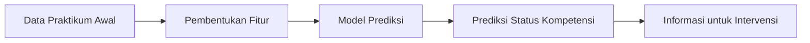
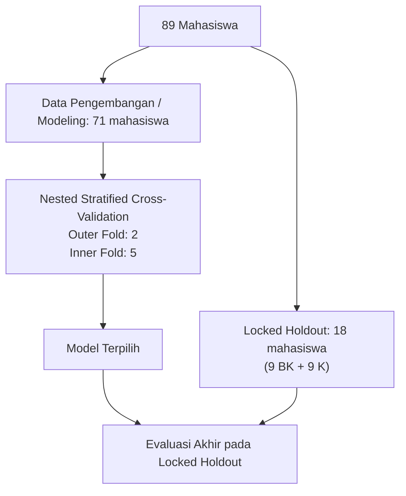

# LAPORAN ANTARA HASIL PENELITIAN

## PENELITIAN DASAR PENGEMBANGAN PRODI

# PEMODELAN PREDIKSI DINI STATUS KOMPETENSI MAHASISWA BERDASARKAN DATA PRAKTIKUM BASIS DATA NON-RELASIONAL MENGGUNAKAN DECISION TREE DAN RANDOM FOREST

**DISUSUN OLEH:**

- Dr. FAISAL, S.T., M.T.
- MUH. HASRUL H., S.Kom., M.Kom.
- NUR RESKI ANUGRAH RAHIM

**LEMBAGA PENELITIAN DAN PENGABDIAN MASYARAKAT (LP2M)**  
**2026**

---

# BAB I. Pendahuluan

## A. Latar Belakang

Perkembangan teknologi informasi yang berlangsung secara eksponensial telah mengubah tuntutan kompetensi lulusan perguruan tinggi, khususnya pada bidang Teknik Informatika. Kompetensi lulusan tidak lagi cukup direpresentasikan oleh penguasaan konsep secara teoritis, tetapi juga oleh kemampuan menerapkan pengetahuan melalui penyelesaian permasalahan komputasional secara nyata. Dalam konteks pendidikan tinggi bidang informatika, praktikum menjadi salah satu wahana penting untuk mengintegrasikan pengetahuan konseptual dengan keterampilan teknis mahasiswa. Kondisi tersebut juga relevan dengan pengembangan kurikulum Program Studi Teknik Informatika UIN Alauddin Makassar yang secara berkala ditinjau untuk menyesuaikan pembelajaran dengan perkembangan teknologi dan kebutuhan dunia industri. Peninjauan kurikulum tahun 2024, misalnya, secara eksplisit diarahkan untuk menghasilkan lulusan yang unggul dan berdaya saing.

Praktikum pada Program Studi Teknik Informatika UIN Alauddin Makassar merupakan bagian dari proses pembelajaran yang memberikan pengalaman langsung kepada mahasiswa dalam mengimplementasikan konsep-konsep informatika. Pelaksanaan praktikum tidak hanya berkaitan dengan penyelesaian tugas, tetapi juga menjadi ruang untuk mengamati kemampuan mahasiswa dalam memahami instruksi, menerapkan konsep, menyelesaikan permasalahan, dan menghasilkan solusi menggunakan teknologi tertentu. Secara institusional, kegiatan praktikum pada Program Studi Teknik Informatika telah dilaksanakan melalui beberapa laboratorium dengan karakteristik kompetensi yang berbeda, seperti laboratorium pemrograman, jaringan komputer, multimedia dan citra digital, serta laboratorium informasi dasar. Hal tersebut menunjukkan bahwa aktivitas praktikum memiliki posisi strategis dalam pembentukan keterampilan praktis mahasiswa Teknik Informatika.

Salah satu kompetensi yang relevan dalam pendidikan Teknik Informatika adalah kemampuan mengelola dan memanfaatkan teknologi basis data. Perkembangan kebutuhan aplikasi digital tidak hanya menghasilkan data dalam struktur tabular yang konvensional, tetapi juga membutuhkan pengelolaan data dengan struktur yang lebih fleksibel dan beragam. Kondisi tersebut mendorong pemanfaatan basis data non-relasional (NoSQL) yang memiliki karakteristik berbeda dengan basis data relasional, termasuk dalam representasi data, fleksibilitas skema, dan mekanisme pengelolaannya. Oleh sebab itu, praktikum basis data non-relasional memiliki nilai strategis dalam membentuk kemampuan teknis mahasiswa, karena mahasiswa tidak hanya dituntut memahami konsep, tetapi juga mampu mengimplementasikan operasi pengelolaan data, melakukan manipulasi dan pencarian data, serta menyelesaikan kasus pengolahan data menggunakan teknologi basis data non-relasional.

Permasalahan yang kemudian muncul adalah data yang dihasilkan selama proses praktikum pada dasarnya tidak hanya berfungsi sebagai bahan pemberian nilai, tetapi juga dapat dipandang sebagai sumber informasi untuk mengidentifikasi perkembangan kompetensi mahasiswa. Aktivitas seperti hasil pengerjaan tugas, nilai setiap modul praktikum, keberhasilan menyelesaikan kasus, ketepatan waktu penyelesaian, tingkat kesalahan, dan capaian proyek dapat membentuk pola tertentu yang merepresentasikan performa mahasiswa. Dalam konteks UIN Alauddin Makassar, pemanfaatan data sebagai dasar analisis akademik sebenarnya memiliki preseden, antara lain penelitian yang menggunakan data profil mahasiswa, riwayat pengambilan mata kuliah, indeks prestasi semester, dan total SKS untuk melakukan proses data mining terhadap masa studi mahasiswa. Namun demikian, pemanfaatan data yang lebih granular pada level aktivitas praktikum untuk memprediksi status kompetensi mahasiswa masih menjadi ruang penelitian yang menarik untuk dikaji.

Evaluasi kompetensi mahasiswa yang hanya dilakukan berdasarkan nilai akhir berpotensi menyebabkan informasi mengenai mahasiswa yang mengalami kesulitan diperoleh ketika proses pembelajaran telah selesai. Pendekatan tersebut kurang memberikan ruang bagi dosen untuk melakukan intervensi secara lebih awal terhadap mahasiswa yang menunjukkan pola performa yang mengarah pada ketidaktercapaian kompetensi. Padahal, data praktikum yang diperoleh secara bertahap selama proses pembelajaran memungkinkan dilakukan pemantauan terhadap perkembangan performa mahasiswa. Oleh karena itu, diperlukan pendekatan yang mampu memanfaatkan data historis dan data aktivitas praktikum untuk menghasilkan prediksi mengenai status kompetensi mahasiswa sebelum evaluasi akhir dilakukan. Konsep prediksi dini dalam penelitian ini menjadi penting karena orientasinya bukan sekadar mengklasifikasikan mahasiswa setelah seluruh pembelajaran berakhir, melainkan menyediakan informasi prediktif yang dapat mendukung pengambilan tindakan akademik secara lebih cepat.

Pemanfaatan data mining dan machine learning memberikan peluang untuk mengembangkan pendekatan tersebut. Data hasil praktikum dapat diposisikan sebagai atribut prediktor, sedangkan status kompetensi mahasiswa digunakan sebagai variabel target yang akan dipelajari oleh model klasifikasi. Dengan pendekatan supervised learning, pola hubungan antara karakteristik performa praktikum dan status kompetensi dapat dipelajari berdasarkan data historis mahasiswa. Pendekatan ini memungkinkan proses evaluasi bergeser dari sekadar assessment of learning menuju pemanfaatan data sebagai dasar predictive assessment. Dengan demikian, hasil analisis tidak hanya menjawab pertanyaan mengenai bagaimana capaian mahasiswa setelah pembelajaran berlangsung, tetapi juga memberikan informasi mengenai mahasiswa yang berpotensi belum mencapai kompetensi sehingga dapat menjadi dasar bagi dosen untuk memberikan pendampingan, remediasi, atau intervensi pembelajaran secara lebih tepat.

Beberapa penelitian sebelumnya yang memanfaatkan data mining dan machine learning dalam memprediksi kinerja akademik diantaranya, Mahmudul Islam dkk (2025) dalam penelitiannya : “The integration of explainable AI in Educational Data Mining for student academic performance predicition and support system”, yang mengusulkan sistem Educational Data Mining (EDM) yang mengintegrasikan machine learning untuk mengklasifikasikan kinerja akademik mahasiswa serta teknik explainable AI untuk memberikan transparansi hasil kinerja.

Sementara itu, Hardik I.Patel dan Dharmendra Patel (2026) dalam penelitiannya : “Evaluation of Machine Learning Models to Predict Student Academic Performance Using Structured Educational Data”, menganalisis penggunaan machine learning untuk memprediksi kinerja akademik mahasiswa dengan memanfaatkan informasi akademik dari institusi yang dikombinasikan dengan informasi sosial-ekonomi dari sumber eksternal.

Dalam penelitian ini, Decision Tree dan Random Forest dipilih sebagai pendekatan pemodelan karena keduanya memiliki hubungan metodologis yang kuat dengan persoalan klasifikasi berbasis data praktikum. Decision Tree memiliki karakteristik model yang relatif mudah diinterpretasikan sehingga dapat digunakan untuk melihat pola pengambilan keputusan berdasarkan atribut performa praktikum. Sementara itu, Random Forest merupakan pendekatan ensemble yang membangun sejumlah pohon keputusan sehingga berpotensi menghasilkan model yang lebih stabil terhadap variasi data dan mampu menangkap pola klasifikasi yang lebih kompleks. Penggunaan kedua algoritma tersebut sekaligus memungkinkan dilakukan analisis komparatif terhadap kemampuan model dalam memprediksi status kompetensi mahasiswa. Selain mengevaluasi performa prediksi melalui ukuran seperti accuracy, precision, recall, dan F1-score, penelitian ini juga dapat mengidentifikasi atribut praktikum yang memiliki kontribusi penting terhadap keputusan klasifikasi sehingga hasil penelitian memiliki nilai interpretatif bagi proses pembelajaran.

Berdasarkan permasalahan tersebut, penelitian ini diarahkan untuk membangun pemodelan prediksi dini status kompetensi mahasiswa berdasarkan data praktikum basis data non-relasional menggunakan Decision Tree dan Random Forest, dengan studi kasus praktikum mahasiswa prodi Teknik Informatika UIN Alauddin Makassar. Fokus penelitian tidak hanya terletak pada perbandingan kinerja kedua algoritma, tetapi juga pada pemanfaatan data praktikum sebagai sumber informasi prediktif untuk mendukung evaluasi kompetensi mahasiswa secara lebih proaktif. Posisi penelitian ini terletak pada integrasi antara konteks pembelajaran praktikum basis data non-relasional, pemodelan klasifikasi, dan kebutuhan early prediction terhadap status kompetensi mahasiswa. Hasil penelitian diharapkan dapat menghasilkan model prediksi yang terukur sekaligus memberikan informasi mengenai pola dan atribut praktikum yang berkontribusi terhadap status kompetensi mahasiswa. Dengan demikian, penelitian ini diharapkan memberikan kontribusi pada pengembangan pendekatan evaluasi pembelajaran berbasis data (data-driven assessment) di lingkungan pendidikan tinggi, khususnya dalam mendukung pengambilan keputusan akademik yang lebih dini, objektif, dan berbasis bukti pada Program Studi Teknik Informatika UIN Alauddin Makassar.

## B. Identifikasi Masalah

Berdasarkan latar belakang di atas, maka dapat ditentukan identifikasi masalah penelitian ini sebagai berikut ini:

1. Tuntutan kompetensi lulusan Teknik Informatika saat ini tidak hanya mencakup penguasaan teori, tetapi juga kemampuan menerapkan pengetahuan dalam penyelesaian permasalahan komputasional nyata, yang perlu diintegrasikan melalui kegiatan praktikum.
2. Evaluasi kompetensi mahasiswa yang hanya mengandalkan nilai akhir berpotensi terlambat dalam mengidentifikasi kesulitan mahasiswa, sehingga membatasi ruang dosen untuk melakukan intervensi dini.
3. Data yang dihasilkan selama proses praktikum, seperti hasil pengerjaan tugas, nilai modul, tingkat kesalahan, dan capaian proyek, berpotensi dimanfaatkan sebagai sumber informasi prediktif untuk mengidentifikasi perkembangan kompetensi mahasiswa.
4. Pemanfaatan data praktikum secara granular untuk memprediksi status kompetensi mahasiswa masih menjadi ruang penelitian yang belum banyak dikaji.
5. Terdapat kebutuhan untuk mengembangkan pendekatan evaluasi pembelajaran berbasis data (data-driven assessment) yang mampu memberikan prediksi dini status kompetensi mahasiswa berdasarkan data aktivitas praktikum.

## B. Rumusan Masalah

Berdasarkan identifikasi masalah di atas, maka dapat ditentukan rumusan masalah penelitian ini yaitu:

1. Bagaimana pola karakteristik data praktikum Basis Data Non-Relasional dan keterkaitannya dengan status kompetensi mahasiswa pada Program Studi Teknik Informatika UIN Alauddin Makassar?
2. Sejauh mana model Decision Tree dan Random Forest mampu memprediksi status kompetensi mahasiswa berdasarkan data praktikum Basis Data Non-Relasional pada Program Studi Teknik Informatika UIN Alauddin Makassar berdasarkan metrik evaluasi klasifikasi?
3. Bagaimana perbedaan kinerja model Decision Tree dan Random Forest dalam memprediksi status kompetensi mahasiswa berdasarkan data praktikum Basis Data Non-Relasional pada Program Studi Teknik Informatika UIN Alauddin Makassar?

## C. Tujuan Penelitian

Penelitian ini bertujuan untuk mengembangkan model prediksi dini status kompetensi mahasiswa berdasarkan data praktikum Basis Data Non-Relasional menggunakan algoritma Decision Tree dan Random Forest pada Program Studi Teknik Informatika UIN Alauddin Makassar. Secara khusus, penelitian ini bertujuan untuk:

1. Menganalisis pola karakteristik data praktikum Basis Data Non-Relasional dan keterkaitannya dengan status kompetensi mahasiswa;
2. Membangun dan mengevaluasi model Decision Tree dan Random Forest dalam memprediksi status kompetensi mahasiswa berdasarkan metrik evaluasi klasifikasi; dan
3. Menganalisis perbedaan kinerja kedua model dalam memprediksi status kompetensi mahasiswa.

## D. Manfaat Penelitian

Secara teoretis, penelitian ini diharapkan berkontribusi terhadap pengembangan kajian mengenai pemanfaatan Educational Data Mining untuk prediksi kompetensi mahasiswa, khususnya dengan mengintegrasikan data performa praktikum Basis Data Non-Relasional sebagai bukti teramati kompetensi pada domain Data Management. Penelitian ini juga memberikan perspektif mengenai penerapan dan perbandingan Decision Tree dan Random Forest dalam pemodelan prediksi status kompetensi mahasiswa.

Secara praktis, hasil penelitian diharapkan dapat mendukung Program Studi Teknik Informatika dan dosen-dosen Prodi Teknik Informatika UIN Alauddin Makassar dalam melakukan pemantauan kompetensi mahasiswa secara lebih berbasis data. Model prediksi yang dikembangkan berpotensi digunakan sebagai salah satu komponen pendukung early warning untuk mengidentifikasi mahasiswa yang memerlukan perhatian atau intervensi pembelajaran sebelum proses pembelajaran berakhir. Bagi peneliti selanjutnya, penelitian ini dapat menjadi landasan untuk pengembangan model prediksi kompetensi pada domain Informatika lainnya, penggunaan sumber data pembelajaran yang lebih beragam, serta pengembangan model yang lebih interpretable.

# BAB II. Kajian Pustaka

## A. Kompetensi Mahasiswa

Kompetensi dalam pendidikan tinggi dapat dipahami sebagai kemampuan yang memungkinkan mahasiswa menunjukkan penguasaan pengetahuan, keterampilan, sikap, nilai, dan perilaku yang relevan melalui performa atau demonstrasi dalam konteks pembelajaran. Konsep competency-based education (CBE) menempatkan capaian kompetensi sebagai fokus pembelajaran dan asesmen. Dengan demikian, pencapaian mahasiswa tidak hanya dilihat berdasarkan penguasaan materi secara konseptual, tetapi juga berdasarkan kemampuan mendemonstrasikan pengetahuan dan keterampilan tersebut dalam konteks tugas yang relevan (Gervais, 2016). Gervais menjelaskan CBE sebagai pendekatan pendidikan berorientasi hasil yang menggunakan pembelajaran dan asesmen untuk menilai penguasaan mahasiswa melalui demonstrasi pengetahuan, sikap, nilai, keterampilan, dan perilaku yang diperlukan.

Dalam konteks pendidikan tinggi di Indonesia, konsep kompetensi lulusan juga ditempatkan sebagai bagian penting dalam standar kompetensi lulusan. Peraturan Menteri Pendidikan, Kebudayaan, Riset, dan Teknologi Nomor 53 Tahun 2023 menyatakan bahwa standar kompetensi lulusan merupakan kriteria minimal mengenai kesatuan kompetensi sikap, keterampilan, dan pengetahuan yang menunjukkan capaian mahasiswa dari hasil pembelajarannya pada akhir program pendidikan tinggi. Berdasarkan ketentuan tersebut, kompetensi tidak semata-mata identik dengan pencapaian nilai akademik, tetapi mencakup berbagai aspek kemampuan yang diperoleh dan ditunjukkan mahasiswa melalui proses pembelajaran. Perspektif kompetensi yang lebih spesifik dalam bidang ilmu komputer dapat ditemukan dalam Computer Science Curricula 2023 (CS2023) yang dikembangkan oleh ACM, IEEE Computer Society, dan AAAI. CS2023 memandang kompetensi dalam ilmu komputer melalui keterkaitan antara knowledge, skills, dan professional dispositions. Pendekatan tersebut menempatkan kemampuan mahasiswa dalam konteks kemampuan yang dapat ditunjukkan melalui penyelesaian tugas, bukan hanya melalui penguasaan materi secara deklaratif (ACM, IEEE-CS, & AAAI, 2024).

CS2023 juga membedakan tingkat pengembangan keterampilan berdasarkan kemampuan yang ditunjukkan mahasiswa, yaitu Explain, Apply, Evaluate, dan Develop. Tingkatan tersebut menunjukkan perkembangan kemampuan dari menjelaskan suatu konsep, menerapkannya dalam konteks tertentu, mengevaluasi solusi atau hasil, sampai mengembangkan solusi. Oleh karena itu, kompetensi dalam ilmu komputer dapat dipahami sebagai kemampuan yang berkembang secara bertahap dan dapat diamati melalui performa mahasiswa dalam menyelesaikan tugas atau permasalahan komputasi.

Berdasarkan perspektif tersebut, kompetensi mahasiswa dalam penelitian ini didefinisikan secara operasional sebagai kemampuan mahasiswa untuk menggunakan pengetahuan dan keterampilan yang relevan dengan bidang Informatika dalam menyelesaikan tugas pembelajaran secara tepat, khususnya pada domain pengelolaan data menggunakan pendekatan basis data non-relasional. Definisi operasional tersebut diperlukan agar konsep kompetensi dapat dihubungkan dengan data performa yang diperoleh dari aktivitas praktikum.

Dengan demikian, penelitian ini tidak dimaksudkan untuk mengukur kompetensi mahasiswa Informatika secara keseluruhan. Kompetensi dibatasi pada kompetensi dalam domain pembelajaran Basis Data Non-Relasional. Status kompetensi yang menjadi target prediksi dibentuk berdasarkan indikator performa yang tersedia dari aktivitas praktikum dan ditentukan menggunakan kriteria penilaian yang telah ditetapkan dalam pembelajaran.

## B. Kompetensi Informatika dan Data Management

Kompetensi mahasiswa Informatika memiliki karakteristik yang berkaitan dengan kemampuan memahami konsep komputasi serta menerapkannya untuk menyelesaikan permasalahan. Dalam CS2023, Data Management merupakan salah satu area penting dalam kurikulum ilmu komputer. Area tersebut mencakup pengetahuan dan keterampilan yang berkaitan dengan bagaimana data dikumpulkan, diorganisasikan, dikelola, diproses, dan digunakan untuk menghasilkan informasi.

CS2023 secara khusus menjelaskan bahwa perkembangan kebutuhan fungsional dan nonfungsional dalam pengelolaan data telah mendorong munculnya alternatif terhadap model relasional. Alternatif tersebut mencakup model non-relasional atau NoSQL. Dalam area Data Management, CS2023 bahkan menetapkan kompetensi “Develop non-relational models” sebagai salah satu kompetensi lulusan dengan tingkat keterampilan Create. Hal ini menunjukkan bahwa kemampuan mengembangkan model data non-relasional dapat ditempatkan secara eksplisit sebagai bagian dari kompetensi ilmu komputer (ACM, IEEE-CS, & AAAI, 2024).

Posisi tersebut memberikan landasan teoritis bagi penelitian ini karena Basis Data Non-Relasional dapat ditempatkan secara langsung dalam domain Data Management pada pendidikan ilmu komputer. Aktivitas mahasiswa dalam merancang model data, melakukan manipulasi data, menggunakan operasi atau query, serta menyelesaikan kasus menggunakan sistem basis data non-relasional dapat dipandang sebagai aktivitas yang memberikan bukti performa terhadap kompetensi Data Management.

Dengan demikian, data hasil praktikum tidak hanya dipandang sebagai nilai akademik, tetapi sebagai representasi performa mahasiswa dalam menyelesaikan aktivitas pembelajaran yang berkaitan dengan kompetensi tertentu. Perspektif tersebut menjadi dasar bagi penelitian ini untuk menggunakan data praktikum Basis Data Non-Relasional sebagai sumber fitur prediktor dalam membangun model prediksi status kompetensi mahasiswa.

Perkembangan pendidikan NoSQL juga menunjukkan meningkatnya relevansi basis data non-relasional dalam pendidikan ilmu komputer. Tripathi (2025) melalui tinjauan sistematis terhadap penelitian pendidikan NoSQL menunjukkan bahwa pembelajaran NoSQL mencakup berbagai model, perangkat, metode pembelajaran, dan aspek integrasi teknologi. Studi tersebut menemukan bahwa basis data berorientasi dokumen dan graf termasuk model yang banyak diajarkan, sedangkan project-based learning menjadi salah satu pendekatan pembelajaran yang umum digunakan.

Berdasarkan perspektif tersebut, kompetensi mahasiswa yang menjadi fokus penelitian ini diarahkan pada kemampuan memahami, menerapkan, mengevaluasi, dan mengembangkan solusi pengelolaan data menggunakan pendekatan basis data non-relasional. Pembatasan tersebut memungkinkan konsep kompetensi dihubungkan secara langsung dengan bukti performa yang dihasilkan dari aktivitas praktikum.

## C. Basis Data Non-Relasional

Basis data non-relasional atau NoSQL merupakan pendekatan pengelolaan data yang berkembang sebagai alternatif terhadap model basis data relasional. Perkembangan tersebut berkaitan dengan kebutuhan aplikasi modern yang memiliki karakteristik data, skala, fleksibilitas struktur, dan kebutuhan pemrosesan yang beragam. Berbeda dengan model relasional yang menggunakan tabel dan hubungan antartabel sebagai struktur utama, basis data NoSQL menyediakan beberapa pendekatan pemodelan data yang disesuaikan dengan karakteristik kebutuhan aplikasi.

Secara umum, basis data NoSQL dapat dikelompokkan ke dalam beberapa model utama, yaitu key-value, document-oriented, column-family atau wide-column, dan graph. Model key-value merepresentasikan data sebagai pasangan kunci dan nilai. Model document-oriented menyimpan data dalam bentuk dokumen yang dapat memiliki struktur bertingkat. Model wide-column mengorganisasikan data berdasarkan kelompok kolom, sedangkan model graph merepresentasikan entitas dan hubungan antarentitas sebagai struktur graf.

Keragaman model tersebut memberikan fleksibilitas dalam merepresentasikan data dan memungkinkan pemilihan model penyimpanan disesuaikan dengan kebutuhan aplikasi. Dalam konteks pendidikan ilmu komputer, pemahaman terhadap model-model tersebut penting karena mahasiswa tidak hanya perlu memahami sintaks atau operasi basis data, tetapi juga perlu memahami bagaimana memilih dan mengembangkan model data yang sesuai dengan karakteristik permasalahan.

Tripathi (2025) menunjukkan bahwa pendidikan NoSQL telah berkembang sebagai bagian dari kebutuhan pembelajaran basis data modern. Tinjauan sistematis tersebut menganalisis 386 publikasi dan memilih 28 penelitian untuk analisis lebih lanjut. Hasilnya menunjukkan bahwa document-oriented database dan graph database termasuk model yang dominan dalam pembelajaran NoSQL, sementara MongoDB, Cassandra, dan Neo4j termasuk teknologi yang banyak digunakan dalam konteks pendidikan.

Dalam konteks penelitian ini, praktikum Basis Data Non-Relasional dipandang sebagai lingkungan pembelajaran yang memungkinkan mahasiswa menunjukkan kompetensi Data Management melalui aktivitas yang konkret. Bukti performa tersebut dapat berupa kemampuan menjalankan operasi basis data, menyelesaikan tugas, membangun atau memanipulasi model data, menghasilkan keluaran yang benar, serta menyelesaikan kesalahan yang muncul selama proses praktikum.

Data yang diperoleh dari aktivitas tersebut selanjutnya dapat digunakan sebagai sumber informasi untuk membentuk fitur prediktor. Dengan demikian, Basis Data Non-Relasional dalam penelitian ini memiliki dua posisi, yaitu sebagai konteks pembelajaran yang menghasilkan bukti performa mahasiswa dan sebagai sumber data yang digunakan dalam pemodelan prediksi.

## D. Educational Data Mining dan Prediksi Performa Mahasiswa

Educational Data Mining (EDM) merupakan bidang interdisipliner yang menggabungkan pendidikan, statistik, data mining, dan teknik machine learning untuk menganalisis data yang dihasilkan dari lingkungan pendidikan. Data tersebut dapat digunakan untuk menemukan pola, memahami karakteristik proses pembelajaran, mengidentifikasi faktor yang berkaitan dengan capaian mahasiswa, serta membangun model prediksi. Salah satu permasalahan penting dalam EDM adalah prediksi performa mahasiswa. Alwarthan (2022) melalui tinjauan sistematis menunjukkan bahwa data pendidikan seperti rekam akademik, karakteristik mahasiswa, aktivitas pembelajaran, dan hasil asesmen telah digunakan sebagai sumber prediktor dalam berbagai penelitian prediksi performa mahasiswa. Pemanfaatan data tersebut bertujuan memperoleh informasi mengenai kemungkinan capaian mahasiswa sebelum hasil akhir pembelajaran diperoleh.

Roslan dan Chen (2022) melakukan systematic literature review terhadap penelitian prediksi performa mahasiswa pada periode 2015–2021. Dari 219 artikel yang diidentifikasi, sebanyak 58 penelitian dianalisis berdasarkan kriteria yang ditetapkan. Hasil kajian menunjukkan bahwa pendekatan klasifikasi merupakan salah satu pendekatan yang paling banyak digunakan dan Decision Tree merupakan salah satu algoritma yang paling sering diterapkan dalam prediksi performa mahasiswa.

Kajian lain oleh Batool et al. (2023) membandingkan sekitar 260 penelitian mengenai prediksi performa mahasiswa selama periode sekitar dua dekade. Kajian tersebut menunjukkan bahwa berbagai jenis data dan teknik data mining telah digunakan dalam prediksi performa mahasiswa, termasuk algoritma prediksi dan seleksi fitur. Hasil tersebut memperlihatkan bahwa pemilihan atribut dan teknik pemodelan merupakan bagian penting dalam pengembangan model prediksi pendidikan.

Dalam penelitian ini, EDM digunakan sebagai kerangka untuk mengubah data aktivitas praktikum menjadi informasi prediktif mengenai status kompetensi mahasiswa. Perbedaan penelitian ini dengan sebagian besar penelitian prediksi performa akademik adalah target yang diprediksi. Penelitian ini tidak diarahkan untuk memprediksi IPK, nilai akhir mata kuliah, atau kelulusan mahasiswa secara umum, tetapi untuk memprediksi status kompetensi mahasiswa pada domain Basis Data Non-Relasional.

Data praktikum dalam penelitian ini dipandang sebagai learning activity data yang memberikan indikator mengenai performa mahasiswa selama proses pembelajaran. Selanjutnya, algoritma klasifikasi digunakan untuk mempelajari pola hubungan antara karakteristik performa praktikum dengan status kompetensi yang telah ditentukan.

Dengan pendekatan tersebut, penelitian ini menempatkan data praktikum sebagai sumber informasi yang lebih spesifik terhadap kompetensi dibandingkan penggunaan data akademik umum. Fokus tersebut sekaligus memberikan ruang untuk menguji sejauh mana data performa praktikum Basis Data Non-Relasional dapat digunakan sebagai prediktor status kompetensi mahasiswa.

## E. Prediksi Dini Status Kompetensi

Prediksi dini merupakan proses menghasilkan estimasi mengenai suatu capaian sebelum seluruh proses pembelajaran selesai. Dalam pendidikan tinggi, pendekatan ini memungkinkan pengajar atau institusi memperoleh informasi mengenai kondisi mahasiswa pada tahap pembelajaran yang masih memungkinkan dilakukannya tindakan tindak lanjut atau intervensi.

Alhazmi dan Sheneamer (2023) menunjukkan bahwa machine learning dapat digunakan untuk melakukan prediksi performa mahasiswa pada tahap awal pendidikan tinggi. Penelitian tersebut menggunakan sejumlah variabel yang tersedia pada tahap awal dan membandingkan beberapa algoritma klasifikasi, termasuk Random Forest. Hasil penelitian menunjukkan potensi penggunaan model prediktif untuk memperoleh informasi mengenai performa mahasiswa sebelum capaian akhir diperoleh.

Penelitian Çırak, Akıllı, dan Ekinci (2024) mengembangkan early warning system untuk memprediksi keberhasilan mahasiswa tahun pertama. Penelitian tersebut menggunakan data 11.698 mahasiswa dan 69 variabel input serta membandingkan beberapa algoritma, termasuk Decision Tree dan Random Forest. Model tersebut dirancang agar informasi prediktif dapat diperoleh pada tahap awal sehingga institusi dapat melakukan tindakan terhadap mahasiswa yang diprediksi mengalami kesulitan sebelum akhir periode akademik.

Konsep prediksi dini dalam penelitian ini diterapkan pada konteks yang lebih spesifik, yaitu aktivitas praktikum Basis Data Non-Relasional. Data yang digunakan sebagai prediktor harus merupakan data yang tersedia sebelum waktu penentuan status kompetensi. Dengan demikian, model tidak sekadar mengklasifikasikan status kompetensi berdasarkan hasil akhir, tetapi memanfaatkan pola performa yang telah terbentuk pada aktivitas praktikum sebelumnya.

Secara konseptual, proses prediksi dini dalam penelitian ini dapat digambarkan sebagai berikut:

Prinsip tersebut mengharuskan adanya pemisahan yang jelas antara data yang digunakan sebagai prediktor dan data yang digunakan untuk menentukan status kompetensi. Pemisahan tersebut diperlukan untuk menghindari data leakage, yaitu kondisi ketika informasi yang seharusnya belum tersedia pada saat prediksi justru digunakan sebagai fitur model.

Dengan demikian, keberhasilan prediksi dini dalam penelitian ini tidak hanya dilihat dari kemampuan model menghasilkan klasifikasi yang benar, tetapi juga dari kemampuan model menghasilkan informasi sebelum status kompetensi ditentukan secara final. Semakin awal data dapat digunakan untuk menghasilkan prediksi dengan kinerja yang tetap memadai, semakin besar potensi pemanfaatannya sebagai informasi pendukung untuk tindakan pembelajaran.

## F. Decision Tree

Decision Tree merupakan algoritma supervised learning yang merepresentasikan proses pengambilan keputusan dalam bentuk struktur pohon. Struktur tersebut terdiri atas simpul keputusan, cabang, dan simpul terminal. Dalam permasalahan klasifikasi, setiap simpul keputusan digunakan untuk melakukan pemisahan data berdasarkan atribut tertentu sehingga observasi dapat diarahkan menuju kelas yang sesuai.

Konsep Decision Tree telah lama menjadi bagian penting dalam pembelajaran mesin dan data mining. Breiman et al. (1984) melalui Classification and Regression Trees memberikan dasar metodologis bagi penggunaan struktur pohon untuk masalah klasifikasi dan regresi. Perkembangan selanjutnya menunjukkan bahwa Decision Tree tetap digunakan secara luas karena struktur modelnya relatif mudah dipahami dan dapat digunakan untuk berbagai permasalahan klasifikasi.

Blockeel et al. (2023) menjelaskan bahwa Decision Tree dan forest merupakan metode yang telah dipelajari dan digunakan secara luas dalam machine learning dan data science. Salah satu karakteristik penting Decision Tree adalah representasi keputusan yang dapat ditelusuri melalui jalur dari akar menuju simpul terminal. Struktur tersebut memungkinkan pengguna melihat kondisi atau aturan yang digunakan model ketika menghasilkan suatu keputusan.

Karakteristik interpretabilitas tersebut menjadi relevan dalam penelitian pendidikan. Model yang digunakan tidak hanya diharapkan mampu menghasilkan prediksi, tetapi juga dapat memberikan gambaran mengenai pola keputusan yang terbentuk dari data. Dalam konteks penelitian ini, pola tersebut dapat digunakan untuk melihat bagaimana kombinasi indikator performa praktikum berkaitan dengan klasifikasi status kompetensi mahasiswa.

Penggunaan Decision Tree dalam penelitian prediksi performa mahasiswa juga didukung oleh kajian Roslan dan Chen (2022), yang menunjukkan bahwa Decision Tree merupakan salah satu algoritma klasifikasi yang paling banyak digunakan dalam penelitian prediksi performa mahasiswa.

Pada penelitian ini, Decision Tree digunakan sebagai salah satu model klasifikasi untuk memprediksi status kompetensi berdasarkan fitur yang berasal dari data praktikum Basis Data Non-Relasional. Model menghasilkan struktur keputusan yang dapat digunakan untuk mengevaluasi hubungan antara fitur performa praktikum dengan status kompetensi.

Selain mengevaluasi kemampuan prediksi, struktur Decision Tree dapat digunakan untuk mengidentifikasi pola keputusan yang terbentuk. Hal tersebut penting karena penelitian ini tidak hanya berorientasi pada perolehan nilai akurasi, tetapi juga pada pemahaman terhadap pola performa yang dapat digunakan sebagai indikator prediksi status kompetensi mahasiswa.

## G. Random Forest

Random Forest merupakan metode ensemble learning yang menggabungkan sejumlah Decision Tree untuk menghasilkan prediksi. Konsep tersebut diperkenalkan oleh Breiman (2001), yang menjelaskan Random Forest sebagai kumpulan tree predictors yang dibangun berdasarkan proses randomisasi. Randomisasi tersebut diterapkan pada pembentukan pohon dan pemilihan fitur yang digunakan pada proses pemisahan.

Berbeda dengan satu Decision Tree yang menghasilkan keputusan berdasarkan satu struktur pohon, Random Forest menghasilkan sejumlah pohon dan menggabungkan hasil prediksi dari pohon-pohon tersebut untuk memperoleh keputusan akhir. Pada permasalahan klasifikasi, keputusan akhir umumnya ditentukan berdasarkan suara mayoritas dari pohon yang membentuk forest.

Breiman (2001) menjelaskan bahwa kemampuan generalisasi Random Forest berkaitan dengan kekuatan masing-masing pohon dan korelasi di antara pohon-pohon tersebut. Pemilihan fitur secara acak pada proses pembentukan pohon merupakan salah satu mekanisme yang digunakan untuk menghasilkan keragaman antar-pohon. Keragaman tersebut menjadi bagian penting dalam mekanisme ensemble pada Random Forest.

Dalam penelitian pendidikan, Random Forest juga telah digunakan dalam berbagai penelitian prediksi performa mahasiswa. Alwarthan (2022) menunjukkan bahwa berbagai algoritma machine learning, termasuk metode berbasis ensemble, telah digunakan dalam penelitian prediksi performa pendidikan. Penelitian Çırak et al. (2024) juga secara langsung membandingkan Random Forest dan Decision Tree dalam pengembangan early warning system untuk mahasiswa tahun pertama.

Pada penelitian ini, Random Forest digunakan sebagai model pembanding terhadap Decision Tree. Perbandingan tersebut dilakukan karena kedua metode memiliki dasar struktur pohon, tetapi memiliki mekanisme pembentukan model yang berbeda. Decision Tree menggunakan satu struktur pohon, sedangkan Random Forest menggabungkan banyak pohon melalui pendekatan ensemble.

Penggunaan kedua algoritma pada dataset dan fitur yang sama memungkinkan penelitian mengevaluasi perbedaan kinerja model dalam memprediksi status kompetensi mahasiswa. Perbandingan tersebut tidak dimaksudkan untuk mengasumsikan sejak awal bahwa salah satu algoritma akan menghasilkan kinerja yang lebih baik, tetapi untuk memperoleh bukti empiris berdasarkan karakteristik data praktikum yang digunakan.

## H. Evaluasi Model Prediksi

Evaluasi model klasifikasi diperlukan untuk mengetahui sejauh mana model mampu mengklasifikasikan status kompetensi mahasiswa secara benar. Karena target penelitian berupa kategori atau status kompetensi, evaluasi dilakukan menggunakan confusion matrix dan sejumlah metrik klasifikasi, antara lain accuracy, precision, recall, dan F1-score.

Confusion matrix digunakan untuk memperlihatkan hubungan antara kelas aktual dan kelas hasil prediksi. Dalam klasifikasi biner, matriks tersebut dapat menunjukkan jumlah true positive, true negative, false positive, dan false negative. Informasi tersebut kemudian digunakan untuk menghitung berbagai metrik evaluasi. Accuracy menunjukkan proporsi keseluruhan prediksi yang diklasifikasikan dengan benar terhadap seluruh observasi. Precision menunjukkan proporsi observasi yang diprediksi sebagai suatu kelas dan benar-benar termasuk dalam kelas tersebut. Recall menunjukkan kemampuan model dalam menemukan observasi yang benar-benar termasuk dalam kelas tertentu. Sementara itu, F1-score merupakan rata-rata harmonis antara precision dan recall sehingga memberikan ukuran yang mempertimbangkan kedua aspek tersebut.

Penggunaan lebih dari satu metrik diperlukan karena accuracy saja belum tentu memberikan gambaran lengkap mengenai kemampuan model, terutama apabila distribusi kelas tidak seimbang. Sebagai contoh, model dapat menghasilkan accuracy yang relatif tinggi apabila sebagian besar data berada pada satu kelas, tetapi masih memiliki kemampuan yang rendah dalam mengidentifikasi kelas dengan jumlah observasi lebih sedikit.

Dalam konteks prediksi status kompetensi, kondisi tersebut menjadi penting karena penelitian dapat memiliki kelas “Kompeten” dan “Belum Kompeten” dengan jumlah data yang berbeda. Oleh sebab itu, evaluasi model dalam penelitian ini tidak hanya menggunakan accuracy, tetapi juga precision, recall, dan F1-score.

Secara khusus, apabila kelas “Belum Kompeten” diposisikan sebagai kelas yang menjadi perhatian dalam prediksi dini, maka recall pada kelas tersebut perlu diperhatikan. Recall menunjukkan kemampuan model dalam mengidentifikasi mahasiswa yang secara aktual termasuk dalam kelas “Belum Kompeten”. Nilai recall yang rendah pada kelas tersebut berarti sebagian mahasiswa yang sebenarnya belum kompeten berpotensi tidak teridentifikasi oleh model. Berdasarkan pertimbangan tersebut, penelitian ini menggunakan confusion matrix, accuracy, precision, recall, dan F1-score sebagai dasar evaluasi. Hasil evaluasi selanjutnya digunakan untuk membandingkan kinerja Decision Tree dan Random Forest dalam memprediksi status kompetensi mahasiswa berdasarkan data praktikum Basis Data Non-Relasional.

Dengan demikian, evaluasi model dalam penelitian ini tidak hanya berorientasi pada seberapa banyak prediksi yang benar, tetapi juga pada kemampuan model mengidentifikasi masing-masing kelas status kompetensi secara proporsional dan relevan dengan tujuan prediksi dini.

## I. Kajian Penelitian Terdahulu

Penelitian mengenai prediksi performa mahasiswa menggunakan Educational Data Mining (EDM)dan machine learning telah berkembang secara signifikan. Tinjauan sistematis Alwarthan (2022) menunjukkan bahwa data mining telah banyak digunakan untuk memprediksi performa akademik mahasiswa di pendidikan tinggi. Kajian tersebut mengidentifikasi berbagai sumber data dan metode prediksi yang digunakan dalam penelitian pendidikan.

Kajian lain oleh Chaka (2022) terhadap penelitian EDM di pendidikan tinggi menunjukkan bahwa Decision Tree merupakan salah satu algoritma yang banyak digunakan dan sering menghasilkan performa prediksi yang baik. Kajian tersebut juga menunjukkan bahwa penelitian prediksi performa mahasiswa masih menggunakan beragam jenis variabel dan pendekatan.

Alhazmi dan Sheneamer (2023) secara khusus membahas prediksi dini performa mahasiswa pada pendidikan tinggi. Penelitian tersebut menegaskan pentingnya penggunaan data yang tersedia pada tahap awal sehingga prediksi dapat digunakan sebelum capaian akhir mahasiswa diketahui. Pada tingkat implementasi model, penelitian Çırak et al. (2024) mengembangkan early warning system untuk mahasiswa tahun pertama menggunakan 11.698 data mahasiswa dan membandingkan beberapa algoritma termasuk Decision Tree dan Random Forest. Penelitian tersebut menunjukkan bahwa data yang tersedia pada tahap awal dapat digunakan untuk membangun model klasifikasi keberhasilan mahasiswa. Penelitian lain juga menunjukkan penggunaan Decision Tree dan Random Forest pada prediksi performa mahasiswa. Misalnya, penelitian di Indonesia mengenai prediksi produktivitas akademik mahasiswa menggunakan kedua algoritma tersebut menunjukkan bahwa Random Forest dapat digunakan untuk melakukan klasifikasi performa akademik berdasarkan data mahasiswa.

Meskipun demikian, sebagian besar penelitian tersebut berfokus pada prestasi akademik, kelulusan, atau performa umum mahasiswa. Variabel target yang digunakan umumnya berupa IPK, nilai akademik, keberhasilan studi, atau kelulusan. Pendekatan tersebut berbeda dengan penelitian ini yang memfokuskan target pada status kompetensi mahasiswa dalam konteks pembelajaran spesifik, yaitu praktikum Basis Data Non-Relasional.

Selain itu, kajian pendidikan NoSQL tahun 2025 menunjukkan bahwa penelitian mengenai pendidikan NoSQL masih relatif berkembang dan banyak berfokus pada model database, perangkat, metode pembelajaran, serta pengembangan kurikulum. ScienceDirect Hal tersebut membuka peluang untuk mengintegrasikan data aktivitas praktikum NoSQL dengan pendekatan educational data mining untuk prediksi kompetensi.

## J. Research Gap dan Posisi Penelitian

Penelitian mengenai penerapan Educational Data Mining untuk memprediksi performa mahasiswa telah berkembang dan menggunakan berbagai algoritma machine learning, termasuk Decision Tree dan Random Forest. Alwarthan et al. (2022) menunjukkan bahwa data mining telah banyak diterapkan untuk memprediksi performa akademik mahasiswa pada pendidikan tinggi, sedangkan Chaka (2022) menunjukkan bahwa Decision Tree merupakan salah satu algoritma yang banyak digunakan dalam penelitian prediksi performa mahasiswa. Penelitian Yağcı (2022) juga menunjukkan bahwa machine learning dapat digunakan untuk mengidentifikasi pola dan memprediksi capaian akademik mahasiswa.

Pengembangan penelitian selanjutnya mengarah pada konsep prediksi dini (early prediction) dan sistem peringatan dini (early warning system). Alhazmi dan Sheneamer (2023) menunjukkan bahwa data yang tersedia pada tahap awal perkuliahan dapat dimanfaatkan untuk memprediksi performa mahasiswa. Çırak et al. (2024) juga mengembangkan early warning system dengan menggunakan 11.698 data mahasiswa dan membandingkan beberapa algoritma, termasuk Decision Tree dan Random Forest. Hasil penelitian menunjukkan bahwa Random Forest mampu mencapai akurasi 90,2% pada dataset yang digunakan.

Meskipun demikian, sebagian besar penelitian tersebut masih menempatkan performa akademik, keberhasilan studi, atau kelulusan sebagai variabel target. Penelitian yang menggunakan nilai praktikum sebagai salah satu prediktor juga telah dilakukan, tetapi konteksnya masih diarahkan pada prediksi performa akademik atau hasil ujian secara umum. Di sisi lain, penelitian mengenai pendidikan Basis Data Non-Relasional masih berkembang. Tripathi (2025), melalui kajian sistematis terhadap 386 artikel dan 28 studi terpilih, menunjukkan bahwa penelitian pendidikan NoSQL terutama membahas model database, tools, metode pembelajaran, dan pengembangan kurikulum. Kajian tersebut belum berfokus pada pemanfaatan data performa praktikum sebagai sumber educational data untuk melakukan prediksi kompetensi mahasiswa.

Berdasarkan kondisi tersebut, terdapat peluang penelitian untuk mengintegrasikan data performa praktikum Basis Data Non-Relasional dengan pendekatan machine learning dalam membangun model prediksi dini status kompetensi mahasiswa. Penelitian ini menggunakan Decision Tree dan Random Forest untuk mengidentifikasi pola serta memprediksi status kompetensi mahasiswa berdasarkan data yang diperoleh dari aktivitas dan hasil praktikum.

Berdasarkan kajian terdahulu, terdapat beberapa celah penelitian yang menjadi dasar penelitian ini.

Pertama, penelitian prediksi mahasiswa umumnya menggunakan prestasi akademik atau kelulusan sebagai target, sedangkan kompetensi sebagai konstruk yang berkaitan langsung dengan kemampuan melakukan tugas pada bidang tertentu masih relatif jarang dijadikan target prediksi. Literatur EDM menunjukkan dominasi penelitian yang memprediksi performa akademik berdasarkan nilai, IPK, karakteristik mahasiswa, dan data akademik lainnya.

Kedua, penelitian prediksi performa mahasiswa umumnya menggunakan data akademik umum atau data learning management system. Penelitian ini menggunakan data praktikum Basis Data Non-Relasional, sehingga sumber data lebih dekat dengan bukti performa teknis mahasiswa pada suatu domain pembelajaran tertentu.

Ketiga, penelitian ini memiliki landasan domain yang lebih spesifik karena CS2023 secara eksplisit menempatkan Data Management sebagai area kompetensi ilmu komputer dan memasukkan kemampuan develop non-relational models sebagai kompetensi. CSED Dengan demikian, penggunaan data praktikum Basis Data Non-Relasional untuk memodelkan kompetensi memiliki keterkaitan langsung dengan kerangka kompetensi pendidikan ilmu komputer.

Keempat, sebagian penelitian prediksi mahasiswa berorientasi pada prediksi hasil akhir, sedangkan penelitian ini menempatkan prediksi dini sebagai bagian penting dari rancangan penelitian. Data prediktor dibatasi pada informasi yang tersedia sebelum status kompetensi akhir ditentukan sehingga model diarahkan untuk memberikan informasi yang dapat digunakan lebih awal. Pendekatan semacam ini relevan dengan perkembangan early warning system pada pendidikan tinggi.

Dengan demikian, posisi penelitian ini adalah mengembangkan model prediksi dini status kompetensi mahasiswa pada praktikum Basis Data Non-Relasional dengan membandingkan Decision Tree dan Random Forest menggunakan data aktivitas dan performa praktikum. Kebaruan penelitian tidak hanya terletak pada penggunaan algoritma, tetapi pada pengaitan kerangka kompetensi Informatika/Data Management dengan data performa praktikum sebagai sumber prediksi status kompetensi.

# BAB III. Metodologi Penelitian

## A. Desain Penelitian

Penelitian ini menggunakan pendekatan kuantitatif dengan desain penelitian berbasis pemodelan prediktif (predictive modeling) dan evaluasi temporal. Penelitian diarahkan untuk membangun model yang mampu melakukan prediksi dini terhadap status kompetensi mahasiswa berdasarkan data performa praktikum Basis Data Non Relasional yang tersedia secara bertahap selama proses pembelajaran.

Karakteristik utama penelitian terletak pada penggunaan dimensi waktu sebagai bagian dari rancangan evaluasi. Berbeda dengan pendekatan retrospektif yang menggunakan agregasi data satu semester, penelitian ini membatasi informasi yang tersedia pada beberapa titik waktu (temporal cutoff), yaitu Minggu ke-1 (W1), Minggu ke-2 (W2), Minggu ke-3 (W3), dan Full Semester. Dengan pendekatan tersebut, penelitian tidak hanya mengevaluasi kemampuan model dalam membedakan mahasiswa Kompeten dan Belum Kompeten, tetapi juga mengidentifikasi seberapa awal informasi performa mahasiswa telah dapat digunakan untuk menghasilkan peringatan.

Secara konseptual, desain penelitian terdiri atas dua bagian utama. Pertama, dilakukan evaluasi retrospektif sebagai baseline untuk mengetahui kemampuan Decision Tree dan Random Forest dalam melakukan klasifikasi berdasarkan data agregasi. Kedua, dilakukan evaluasi temporal untuk mengetahui perubahan kinerja model ketika informasi akademik dibatasi berdasarkan waktu pengamatan. Model yang digunakan terdiri atas Decision Tree dan Random Forest. Decision Tree digunakan karena struktur keputusan yang dihasilkan relatif mudah diinterpretasikan, sedangkan Random Forest digunakan sebagai model pembanding berbasis ensemble. Perbandingan kedua model diperlukan untuk mengetahui apakah penggunaan beberapa pohon keputusan secara agregatif memberikan karakteristik prediksi yang berbeda dibandingkan satu pohon keputusan.

Evaluasi model dilakukan dengan menggunakan nested stratified cross-validation dan locked holdout. Dokumen penelitian mencatat penggunaan 2 outer folds × 5 inner folds untuk validasi nested serta 18 mahasiswa sebagai data locked holdout.

Dengan demikian, alur desain penelitian dapat dirumuskan sebagai:

```mermaid
flowchart LR
    A["Data Mahasiswa"] --> B["Pembentukan Status Kompetensi"] --> C["Preprocessing"] --> D["Feature Engineering"] --> E["Pembentukan Skenario Temporal"] --> F["Pembagian Data Pengembangan dan Locked Holdout"]
    F --> G["Nested Stratified Cross-Validation<br/>(2 Outer Folds x 5 Inner Folds)"] --> H["Pelatihan Decision Tree dan Random Forest"] --> I["Evaluasi Holdout"] --> J["Perbandingan Model"] --> K["Interpretasi Fitur / SHAP"] --> L["Identifikasi Cutoff untuk Early Warning System"]
```

Desain tersebut memungkinkan penelitian menjawab dua pertanyaan utama, yaitu: (1) bagaimana kemampuan Decision Tree dan Random Forest dalam memprediksi status kompetensi mahasiswa; dan (2) pada titik waktu berapa informasi praktikum telah cukup informatif untuk mendukung sistem peringatan dini.

## B. Populasi dan Sampel

### 1. Populasi

Populasi dalam penelitian ini adalah mahasiswa semester VI Program Studi Teknik Informatika UIN Alauddin Makassar yang mengikuti praktikum Basis Data Non Relasional pada periode semester genap 2025/2026 sebagai objek penelitian sebanyak 89 orang yang terdiri atas 4 kelas praktikum.

Penetapan populasi tersebut disesuaikan dengan tujuan penelitian karena unit analisis yang digunakan adalah mahasiswa yang memiliki rekam data aktivitas dan hasil praktikum Basis Data Non Relasional. Dengan demikian, populasi tidak mencakup seluruh mahasiswa Program Studi Teknik Informatika, tetapi dibatasi pada mahasiswa yang mengikuti praktikum dan memiliki data yang diperlukan untuk proses pemodelan.

Pembatasan populasi tersebut penting karena penelitian tidak bermaksud melakukan prediksi kompetensi mahasiswa secara umum dalam seluruh bidang Teknik Informatika. Model yang dikembangkan secara khusus diarahkan untuk memprediksi status kompetensi yang berkaitan dengan pembelajaran dan praktikum Basis Data Non Relasional.

### 2. Sampel

Sampel penelitian merupakan bagian dari populasi yang memenuhi kriteria untuk digunakan dalam proses pemodelan. Sebanyak 18 orang dari total 89 mahasiswa peserta praktikum Basis Data Non Relasional yang dijadikan sampel dalam penelitian ini.

## C. Sumber Data

Sumber data penelitian ini terdiri atas data primer dan data sekunder yang berasal dari data aktivitas dan performa praktikum mahasiswa yang digunakan untuk membentuk representasi performa akademik. Data tersebut selanjutnya diolah menjadi atribut yang merepresentasikan tingkat performa, penyelesaian aktivitas, konsistensi, serta indikator performa pada fase awal pembelajaran.

Data praktikum dipandang sebagai sumber informasi utama karena penelitian bertujuan melakukan prediksi status kompetensi berdasarkan informasi yang tersedia selama proses pembelajaran, bukan hanya berdasarkan nilai akhir semester.

Data kemudian dibentuk menjadi beberapa representasi fitur. Salah satu konfigurasi yang digunakan adalah kombinasi fitur Mean, Completion, dan Variability. Ketiga kelompok fitur tersebut merepresentasikan tingkat performa, tingkat penyelesaian aktivitas, dan konsistensi performa mahasiswa.

Selain representasi retrospektif, data juga disusun berdasarkan temporal cutoff, yaitu: W1, informasi sampai Minggu ke-1; W2, informasi sampai Minggu ke-2; W3, informasi sampai Minggu ke-3; Full Semester, seluruh informasi yang tersedia selama semester.

Penggunaan beberapa cutoff tersebut memungkinkan informasi akademik diperlakukan sebagai data yang berkembang dari waktu ke waktu sehingga dapat digunakan untuk mengevaluasi fungsi Early Warning System (EWS).

### 1. Data Primer

Data primer merupakan data yang diperoleh secara langsung dari proses pelaksanaan atau penilaian praktikum Basis Data Non Relasional. Data primer dalam penelitian ini meliputi : data Absensi/kehadiran, data Responsi/Tugas Pendahuluan, data Laporan dan data Nilai Akhir Praktikum.

### 2. Data Sekunder

Data sekunder diperoleh dari dokumen akademik dan administrasi praktikum yang telah tersedia. Data sekunder dalam penelitian ini meliputi :

- daftar peserta praktikum;
- daftar nilai praktikum;
- rekapitulasi penilaian;
- data hasil tugas;
- dokumen rubrik penilaian;
- dokumen atau instrumen penilaian kompetensi.

Data sekunder digunakan sebagai pelengkap untuk membentuk dataset penelitian dan memastikan bahwa atribut yang digunakan dalam pemodelan memiliki dasar yang jelas.

## D. Variabel dan Atribut Penelitian

Variabel penelitian terdiri atas variabel prediktor berupa atribut performa praktikum dan variabel target berupa status kompetensi mahasiswa.

### 1. Variabel Prediktor

Atribut prediktor dibangun dari data aktivitas praktikum dan dikelompokkan ke dalam beberapa representasi.

**Tabel 3.1. Atribut Prediktor**

| Kelompok atribut | Representasi | Fungsi |
|---|---|---|
| Mean | Rata-rata performa | Merepresentasikan tingkat performa mahasiswa |
| Completion | Penyelesaian aktivitas | Merepresentasikan tingkat penyelesaian aktivitas praktikum |
| Variability | Variabilitas performa | Merepresentasikan konsistensi performa |
| Absence | Ketidakhadiran/ketidaktersediaan aktivitas | Digunakan pada konfigurasi tertentu |
| Early Performance | Performa fase awal | Merepresentasikan sinyal performa pada tahap awal pembelajaran |

Konfigurasi fitur retrospektif yang diuji dalam penelitian meliputi Base Mean, Mean + Completion + Absence, dan Mean + Completion + Variability. Pada konfigurasi S3 digunakan enam fitur yang merepresentasikan Mean, Completion, dan Variability.

Variability digunakan untuk menangkap informasi yang tidak selalu terlihat dari nilai rata-rata. Dua mahasiswa dengan rata-rata performa yang sama dapat mempunyai pola yang berbeda apabila salah satunya menunjukkan performa stabil sedangkan mahasiswa lainnya mengalami fluktuasi.

Dalam skenario EWS, penelitian juga menggunakan Early_Performance_Composite sebagai representasi indikator performa awal. Fitur tersebut digunakan untuk melihat apakah trajectory performa pada fase awal memberikan kontribusi prediktif terhadap status kompetensi akhir.

### 2. Variabel Target

Variabel target adalah Status Kompetensi Mahasiswa, yang terdiri atas dua kelas yaitu : Kompeten (K) dan Belum Kompeten (BK). Variabel target tersebut digunakan sebagai kelas yang diprediksi oleh Decision Tree dan Random Forest.

## E. Definisi dan Penentuan Status Kompetensi

Status kompetensi dalam penelitian ini merupakan variabel target operasional yang digunakan untuk membedakan mahasiswa berdasarkan kriteria kompetensi yang ditetapkan dalam penelitian. Mahasiswa dikelompokkan ke dalam dua kategori, yaitu Kompeten dan Belum Kompeten. Pembentukan target menggunakan ambang nilai 83 sebagai kriteria operasional penelitian.

Status kompetensi tersebut berfungsi sebagai label target, bukan sebagai variabel yang digunakan untuk menentukan intervensi secara otomatis. Dalam konteks implementasi EWS, prediksi model diposisikan sebagai informasi pendukung bagi pengajar, sedangkan keputusan intervensi tetap berada pada ranah profesional pengajar.

## F. Tahapan Pengolahan Data

Tahapan pengolahan data dalam penelitian ini dirancang untuk mengubah data aktivitas praktikum menjadi model prediksi dini status kompetensi. Tahapan penelitian dapat dijelaskan sebagai berikut.

### 1. Pengumpulan Data

Data aktivitas dan performa praktikum mahasiswa dikumpulkan sebagai sumber data penelitian.

### 2. Pembentukan Target

Data mahasiswa dikategorikan ke dalam kelas Kompeten dan Belum Kompeten berdasarkan kriteria operasional yang digunakan penelitian.

### 3. Data Preprocessing

Data dipersiapkan sebelum digunakan dalam proses pemodelan. Tahap ini mencakup proses pembersihan dan pembentukan representasi data yang diperlukan oleh model.

### 4. Feature Engineering

Data aktivitas praktikum ditransformasikan menjadi fitur yang merepresentasikan Mean, Completion, Variability, dan atribut lainnya sesuai skenario eksperimen.

### 5. Pembentukan Skenario Temporal

Data disusun berdasarkan cutoff W1, W2, W3, dan Full Semester. Pendekatan tersebut memungkinkan penelitian mengukur kemampuan model dalam menghasilkan prediksi pada tingkat ketersediaan informasi yang berbeda.

### 6. Pembentukan Data Pengembangan dan Locked Holdout

Sebagian data digunakan untuk proses pengembangan dan validasi model, sedangkan 18 mahasiswa disimpan sebagai locked holdout untuk evaluasi akhir.

### 7. Nested Stratified Cross-Validation

Proses pengembangan model menggunakan nested stratified cross-validation dengan 2 outer folds dan 5 inner folds. Pendekatan ini digunakan untuk mengurangi optimistic bias yang dapat muncul akibat proses tuning dan seleksi model.

### 8. Pemodelan

Dua algoritma digunakan, yaitu: Decision Tree dan Random Forest. Kedua algoritma dievaluasi pada konfigurasi fitur yang berbeda untuk mengetahui pengaruh representasi fitur terhadap performa model.

### 9. Evaluasi Model

Model dievaluasi menggunakan metrik yang sesuai dengan karakteristik EWS, meliputi Recall BK, Precision BK, F2, Specificity, Balanced Accuracy, MCC, Accuracy, dan PR-AUC. Recall BK diberi perhatian khusus karena dalam konteks EWS kesalahan berupa mahasiswa Belum Kompeten yang tidak terdeteksi (false negative) mempunyai konsekuensi lebih besar dibandingkan false positive.

### 10. Interpretasi Model

Interpretasi dilakukan menggunakan feature importance dan SHAP untuk mengidentifikasi atribut yang memberikan kontribusi terhadap prediksi model. SHAP digunakan untuk menjelaskan kontribusi prediktif fitur dan tidak ditafsirkan sebagai hubungan sebab-akibat.

### 11. Evaluasi Temporal dan Penentuan Kandidat Cutoff EWS

Hasil dari W1, W2, W3, dan Full Semester dibandingkan untuk mengetahui titik waktu yang memberikan kombinasi antara kemampuan mendeteksi mahasiswa Belum Kompeten dan beban false alarm yang masih dapat dikelola.

## G. Data Preprocessing

Data Preprocessing adalah data awal yg diperoleh dari asisten, berupa data hasil penilaian praktikum Basis Data Non Relasional. Data yang dimaksud meliputi data nilai absensi/kehadiran, nilai tugas pendahuluan (TP), nilai laporan dan nilai ujian akhir praktikum, yang terangkum sebagai file excel. Data preprocessing dilakukan untuk memastikan bahwa data yang digunakan dalam pemodelan berada dalam bentuk yang sesuai (tidak ada duplikasi data dan nilai kosong) dan tidak menyebabkan informasi dari data pengujian masuk ke dalam proses pengembangan model.

Salah satu prinsip penting yang digunakan adalah isolasi preprocessing, yaitu proses preprocessing tidak boleh menggunakan informasi dari locked holdout. Hal tersebut merupakan bagian dari disiplin evaluasi yang digunakan untuk mengurangi risiko optimistic bias.

Pada tahap berikutnya dilakukan feature engineering untuk membentuk representasi performa mahasiswa. Penelitian membandingkan beberapa konfigurasi fitur, yaitu:

**Tabel 3.2. Feature Representasi**

| Skenario | Model | Jumlah Fitur | Representasi |
|---|---|---:|---|
| S1 | Random Forest | 3 | Base Mean |
| S2 | Decision Tree | 6 | Mean + Completion + Absence |
| S2 | Random Forest | 6 | Mean + Completion + Absence |
| S3 | Decision Tree | 6 | Mean + Completion + Variability |
| S3 | Random Forest | 6 | Mean + Completion + Variability |

Konfigurasi S3 menjadi penting karena menggabungkan tiga dimensi perilaku mahasiswa, yaitu tingkat performa, penyelesaian aktivitas, dan konsistensi. Penelitian menunjukkan bahwa penambahan jumlah fitur tidak menghasilkan peningkatan performa secara linear. Dalam pengolahan temporal, fitur kemudian dihitung berdasarkan informasi yang tersedia pada masing-masing cutoff. Dengan demikian, fitur pada W1 hanya boleh menggunakan informasi sampai W1, fitur W2 menggunakan informasi sampai W2, dan seterusnya. Prinsip ini diperlukan agar model benar-benar mensimulasikan kondisi prediksi yang tersedia pada waktu tersebut.

## H. Pembagian Data Training dan Testing

Pembagian data dalam penelitian ini menggunakan konsep data pengembangan/modeling dan locked holdout. Dari 89 mahasiswa yang dianalisis, terbagi dalam 80% (71 orang) data training dan 20% (18 orang) ditetapkan sebagai locked holdout, atau terdiri atas 9 mahasiswa Kompeten dan 9 mahasiswa Belum Kompeten. Data holdout tidak digunakan dalam proses pengembangan atau pemilihan model dan digunakan sebagai evaluasi akhir.

Secara konseptual, struktur pembagian data dapat digambarkan sebagai berikut:

Penggunaan nested cross-validation dimaksudkan untuk memisahkan proses pemilihan/tuning model dari proses evaluasi, sehingga estimasi performa tidak terlalu optimistis. Sementara itu, locked holdout digunakan sebagai pengujian akhir terhadap data yang tidak ikut berperan dalam pemilihan model.

Stratifikasi digunakan agar distribusi kelas Kompeten dan Belum Kompeten tetap diperhatikan pada proses validasi. Hal ini relevan karena target penelitian terdiri atas dua kelas dan penelitian menempatkan Recall terhadap kelas Belum Kompeten sebagai salah satu perhatian utama.

Pada tahap evaluasi temporal, locked holdout yang sama digunakan untuk membandingkan W1, W2, W3, dan Full Semester. Dengan demikian, perbedaan performa antar-cutoff dapat dibaca sebagai perubahan akibat jumlah informasi temporal yang tersedia, bukan semata-mata akibat perubahan sampel pengujian.

## I. Pemodelan Decision Tree dan Random Forest

Pemodelan dalam penelitian ini dilakukan untuk membangun model prediksi dini status kompetensi mahasiswa berdasarkan data performa Praktikum Basis Data Non Relasional. Dua algoritma klasifikasi yang digunakan adalah Decision Tree dan Random Forest. Kedua algoritma tersebut dipilih karena mampu melakukan klasifikasi berdasarkan hubungan antara sejumlah atribut prediktor dengan variabel target berupa status kompetensi mahasiswa. Data hasil praktikum yang telah melalui tahap preprocessing digunakan sebagai masukan dalam proses pembentukan model, sedangkan status kompetensi mahasiswa digunakan sebagai variabel target.

Model Decision Tree dibangun dengan membentuk struktur pohon keputusan yang terdiri atas node, cabang, dan leaf. Pada setiap proses pemisahan data, algoritma menentukan atribut yang paling sesuai untuk membedakan kelas berdasarkan ukuran impurity, seperti Gini Impurity atau Information Gain. Proses tersebut dilakukan secara rekursif hingga terbentuk struktur pohon yang dapat digunakan untuk melakukan klasifikasi. Dalam penelitian ini, Decision Tree menghasilkan aturan keputusan yang digunakan untuk memprediksi apakah seorang mahasiswa termasuk dalam kategori Kompeten atau Belum Kompeten berdasarkan karakteristik data praktikum.

Selanjutnya, Random Forest digunakan sebagai model ensemble yang terdiri atas sejumlah Decision Tree. Setiap pohon dibangun menggunakan sampel data hasil bootstrap dan subset atribut yang dipilih secara acak. Setiap pohon menghasilkan prediksi terhadap status kompetensi mahasiswa, kemudian seluruh hasil prediksi tersebut digabungkan menggunakan mekanisme voting mayoritas untuk menghasilkan prediksi akhir. Pendekatan ini memungkinkan model memanfaatkan informasi dari banyak pohon keputusan sehingga tidak hanya bergantung pada satu struktur pohon dalam melakukan klasifikasi.

Tahapan pemodelan diawali dengan pembagian dataset menjadi data training dan data testing. Data training digunakan untuk membangun model Decision Tree dan Random Forest, sedangkan data testing digunakan untuk mengukur kemampuan generalisasi kedua model terhadap data yang tidak digunakan pada proses pembelajaran. Pembagian data dilakukan dengan mempertahankan proporsi kelas target melalui stratified splitting apabila kondisi dan distribusi data memungkinkan.

Model Decision Tree dan Random Forest yang telah dibangun selanjutnya digunakan untuk melakukan prediksi terhadap data testing. Hasil prediksi masing-masing model dibandingkan dengan status kompetensi aktual mahasiswa untuk memperoleh nilai evaluasi. Evaluasi dilakukan menggunakan confusion matrix serta metrik accuracy, precision, recall, dan F1-score. Penggunaan beberapa metrik dilakukan agar performa model dapat dinilai secara lebih komprehensif, terutama apabila distribusi antara mahasiswa yang berstatus Kompeten dan Belum Kompeten tidak seimbang.

Hasil evaluasi kedua model selanjutnya dianalisis secara komparatif berdasarkan nilai metrik yang diperoleh. Analisis tidak dilakukan dengan menetapkan terlebih dahulu algoritma yang dianggap lebih baik, tetapi berdasarkan hasil pengujian terhadap dataset penelitian. Selain performa klasifikasi, penelitian juga dapat menganalisis feature importance untuk mengidentifikasi atribut data praktikum yang memberikan kontribusi relatif besar terhadap proses prediksi status kompetensi mahasiswa.

Dengan tahapan tersebut, pemodelan penelitian menghasilkan dua model klasifikasi, yaitu model Decision Tree dan Random Forest, yang digunakan untuk memprediksi status kompetensi mahasiswa berdasarkan data Praktikum Basis Data Non Relasional. Hasil pemodelan kemudian menjadi dasar untuk mengevaluasi kemampuan prediksi dini dan mengidentifikasi atribut performa praktikum yang relevan dalam pembentukan status kompetensi mahasiswa.

# BAB IV. Hasil dan Pembahasan

## A. Hasil Penelitian

### 1. Karakteristik Data dan Rancangan Evaluasi

Analisis menggunakan data dari 89 mahasiswa, yang terdiri atas 45 mahasiswa berstatus Belum Kompeten (BK) dan 44 mahasiswa berstatus Kompeten. Evaluasi akhir dilakukan pada locked holdout yang berisi 18 mahasiswa, masing-masing 9 mahasiswa BK dan 9 mahasiswa Kompeten. Proses validasi menggunakan nested stratified cross-validation dengan 2 outer folds dan 5 inner folds. Untuk mengevaluasi potensi sistem peringatan dini (early warning system/EWS), kinerja dibandingkan pada cutoff temporal Minggu ke-1 (W1), Minggu ke-2 (W2), Minggu ke-3 (W3), dan Full Semester.

### 2. Hasil Evaluasi Temporal Sistem Peringatan Dini

Hasil evaluasi pada locked holdout menunjukkan adanya perbedaan kinerja antara cutoff awal dan penggunaan data satu semester penuh. W1 mampu mendeteksi sebagian besar mahasiswa BK, tetapi tidak dapat mengenali mahasiswa Kompeten pada sampel pengujian. Pada W2 dan W3, Recall BK mencapai 100% dan Balanced Accuracy sebesar 77,78%. Penggunaan data Full Semester mempertahankan Balanced Accuracy 77,78%, tetapi Recall BK turun menjadi 88,89% dan specificity meningkat menjadi 66,67%.

**Tabel 4.1. Rekapitulasi metrik evaluasi EWS pada locked holdout**

| Cutoff | Recall BK | Precision BK | F2 BK | Specificity | Balanced Accuracy | MCC | Accuracy |
|---|---:|---:|---:|---:|---:|---:|---:|
| W1 | 88,89% | 47,06% | 75,47% | 0,00% | 44,44% | 0,00 | 44,44% |
| W2 | 100,00% | 69,23% | 91,84% | 55,56% | 77,78% | 0,57 | 77,78% |
| W3 | 100,00% | 69,23% | 91,84% | 55,56% | 77,78% | 0,57 | 77,78% |
| Full Semester | 88,89% | 72,73% | 85,11% | 66,67% | 77,78% | 0,58 | 77,78% |

### 3. Confusion Matrix pada Setiap Cutoff

Confusion matrix memperlihatkan jumlah prediksi benar dan salah pada setiap cutoff. Pada W1, delapan dari sembilan mahasiswa BK terdeteksi, sedangkan seluruh mahasiswa Kompeten diprediksi sebagai BK. Pada W2 dan W3, seluruh mahasiswa BK terdeteksi, tetapi empat mahasiswa Kompeten juga menerima peringatan. Pada Full Semester, delapan mahasiswa BK terdeteksi dan satu mahasiswa BK tidak terdeteksi; tiga mahasiswa Kompeten menerima peringatan, sedangkan enam lainnya diklasifikasikan dengan benar.

**Tabel 4.2. Ringkasan confusion matrix pada setiap cutoff**

| Cutoff | Aktual BK → Prediksi BK | Aktual BK → Prediksi Kompeten | Aktual Kompeten → Prediksi BK | Aktual Kompeten → Prediksi Kompeten |
|---|---:|---:|---:|---:|
| W1 | 8 | 1 | 9 | 0 |
| W2 | 9 | 0 | 4 | 5 |
| W3 | 9 | 0 | 4 | 5 |
| Full Semester | 8 | 1 | 3 | 6 |

### 4. Jumlah Mahasiswa yang Mendapat Peringatan

Jumlah mahasiswa yang ditandai oleh model berbeda menurut cutoff. Pada W1, sebanyak 17 dari 18 mahasiswa mendapat peringatan. Pada W2 dan W3, jumlah tersebut turun menjadi 13 mahasiswa. Pada Full Semester, 11 mahasiswa menerima peringatan. Berdasarkan confusion matrix, jumlah false negative masing-masing adalah 1 pada W1, 0 pada W2, 0 pada W3, dan 1 pada Full Semester.

**Tabel 4.3. Jumlah peringatan dan jenis kesalahan klasifikasi**

| Cutoff | Jumlah menerima peringatan | False negative (BK yang terlewat) | False positive (Kompeten yang diperingatkan) |
|---|---:|---:|---:|
| W1 | 17 | 1 | 9 |
| W2 | 13 | 0 | 4 |
| W3 | 13 | 0 | 4 |
| Full Semester | 11 | 1 | 3 |

### 5. Hasil Evaluasi Baseline Retrospektif

Evaluasi retrospektif membandingkan lima konfigurasi model dan fitur. Decision Tree S3 memperoleh Test Balanced Accuracy 77,78% dan Test Recall BK 100%. Random Forest S3 juga memperoleh Test Balanced Accuracy 77,78%, tetapi Test Recall BK sebesar 77,78% dan PR-AUC 0,892. Random Forest S1 menghasilkan PR-AUC 0,858 dan Test Balanced Accuracy 66,67%. Nilai-nilai ini menunjukkan bahwa hasil dapat berbeda menurut metrik yang digunakan.

**Tabel 4.4. Ringkasan hasil evaluasi baseline retrospektif**

| Skenario | Model | Fitur | CV BA | CV Recall BK | Test BA | Test Recall BK | PR-AUC |
|---|---|---|---:|---:|---:|---:|---:|
| S3 | Decision Tree | 6 (Mean + Completion + Variability) | 62,39% | 64,21% | 77,78% | 100,00% | 0,738 |
| S2 | Decision Tree | 6 (Mean + Completion + Absence) | 63,71% | 57,14% | 72,22% | 100,00% | 0,748 |
| S1 | Random Forest | 3 (Base Mean) | 65,60% | 63,21% | 66,67% | 88,89% | 0,858 |
| S2 | Random Forest | 6 (Mean + Completion + Absence) | 68,17% | 65,50% | 77,78% | 77,78% | 0,864 |
| S3 | Random Forest | 6 (Mean + Completion + Variability) | 65,17% | 68,07% | 77,78% | 77,78% | 0,892 |

### 6. Ketidakpastian Estimasi Kinerja

Dokumen sumber melaporkan interval kepercayaan bootstrap 95% untuk evaluasi Full Semester. Recall BK sebesar 88,89% memiliki interval 62,50%–100,00%; Balanced Accuracy sebesar 77,78% memiliki interval 56,15%–95,45%; dan F2 BK sebesar 85,11% memiliki interval 62,46%–98,04%. Interval yang lebar menunjukkan bahwa estimasi kinerja pada sampel holdout berukuran kecil masih mengandung ketidakpastian yang cukup besar.

**Tabel 4.5. Estimasi kinerja Full Semester dan interval ketidakpastian bootstrap (B=1000)**

| Metrik | Estimasi holdout | 95% CI bootstrap |
|---|---:|---:|
| Recall BK | 88,89% | 62,50%–100,00% |
| Balanced Accuracy | 77,78% | 56,15%–95,45% |
| F2 BK | 85,11% | 62,46%–98,04% |

### 7. Temuan Interpretabilitas Model

Analisis SHAP pada model retrospektif melaporkan Laporan_Mean sebagai salah satu fitur dominan. Pada model EWS, ketika Early_Performance_Composite dimasukkan ke ruang fitur, perhatian model bergeser ke indikator fase awal.

## B. Pembahasan Hasil Penelitian

### 1. Evaluasi Temporal bagi Sistem Peringatan Dini

Temuan utama penelitian bukan hanya nilai kinerja tertinggi, melainkan waktu ketika data telah cukup informatif untuk mendukung peringatan awal. Model yang menggunakan data satu semester penuh memang memiliki informasi lebih lengkap, tetapi informasi tersebut tersedia lebih lambat. Dalam konteks EWS, kualitas prediksi perlu dipertimbangkan bersama kecepatan prediksi karena tujuan sistem adalah memberi kesempatan kepada pengajar untuk melakukan intervensi sebelum kompetensi akhir ditetapkan. Hasil W1 memperlihatkan keterbatasan penggunaan data yang sangat dini. Recall BK sebesar 88,89% disertai specificity 0% berarti model mendeteksi hampir semua mahasiswa BK, tetapi seluruh sembilan mahasiswa Kompeten pada holdout juga mendapat peringatan. Pada W2, Recall BK mencapai 100%, specificity meningkat menjadi 55,56%, dan Balanced Accuracy menjadi 77,78%. W3 tidak memberikan peningkatan pada metrik-metrik tersebut dibandingkan W2. Dengan demikian, W2 merupakan kandidat cutoff yang menjanjikan dalam data penelitian ini, bukan bukti bahwa W2 selalu optimal pada seluruh angkatan.

### 2. Trade-off antara False Alarm dan Risiko yang Terlewat

W2 dan W3 menghasilkan nol false negative pada sampel holdout, tetapi empat mahasiswa Kompeten tetap menerima peringatan. Untuk EWS akademik, kesalahan tersebut perlu dibaca berdasarkan konsekuensi tindak lanjutnya. Apabila peringatan hanya memicu monitoring, konsultasi singkat, atau pemeriksaan aktivitas, false positive mungkin masih dapat dikelola. Sebaliknya, false negative berpotensi membuat mahasiswa yang memerlukan dukungan tidak teridentifikasi. Karena itu, pemilihan cutoff sebaiknya mempertimbangkan biaya intervensi dan risiko mahasiswa yang terlewat, bukan hanya satu metrik agregat. Nilai F2 sebesar 91,84% pada W2 dan W3 mendukung orientasi yang lebih menekankan recall daripada precision. Namun, F2 bukan persentase seluruh prediksi yang benar. Metrik tersebut harus dibaca bersama confusion matrix, precision, specificity, Balanced Accuracy, dan MCC agar konsekuensi kesalahan klasifikasi tetap terlihat.

### 3. Balanced Accuracy Lebih Informatif daripada Accuracy Saja

Dalam data holdout yang relatif seimbang, Accuracy dan Balanced Accuracy memiliki nilai yang sama pada setiap cutoff yang dilaporkan. Meskipun demikian, Balanced Accuracy tetap relevan karena merangkum recall pada kedua kelas. Pada W1, nilai 44,44% mencerminkan kegagalan model mengenali kelas Kompeten. Pada W2 dan W3, nilai 77,78% menunjukkan peningkatan keseimbangan pengenalan kelas. Full Semester mempertahankan Balanced Accuracy yang sama, sehingga tambahan informasi hingga akhir semester tidak meningkatkan ukuran diskriminasi ini pada holdout. Hasil baseline retrospektif juga memperlihatkan bahwa metrik yang berbeda dapat menghasilkan penilaian berbeda. Random Forest S3 memiliki PR-AUC tertinggi sebesar 0,892, sementara Decision Tree S3 menghasilkan Test Recall BK 100% dan Test Balanced Accuracy 77,78%. PR-AUC menggambarkan kemampuan pemeringkatan pada berbagai threshold, sedangkan Balanced Accuracy menilai keputusan pada threshold yang digunakan. Oleh karena itu, model EWS tidak seharusnya dipilih hanya berdasarkan satu metrik.

### 4. Perbandingan Decision Tree dan Random Forest

Decision Tree S3 menunjukkan kombinasi yang relevan untuk EWS pada holdout: Recall BK 100%, Balanced Accuracy 77,78%, dan struktur keputusan yang relatif mudah ditelusuri. Kemudahan interpretasi dapat membantu pengajar memahami alasan mahasiswa ditandai oleh sistem. Random Forest tetap berfungsi sebagai model pembanding yang penting; pada konfigurasi S3, model ini memperoleh PR-AUC 0,892, tetapi Recall BK pada holdout lebih rendah, yaitu 77,78%. Hasil tersebut tidak membuktikan bahwa Decision Tree selalu lebih baik daripada Random Forest. Kesimpulan yang lebih terbatas dan sesuai data adalah bahwa Decision Tree S3 tampak sesuai dengan prioritas deteksi risiko pada holdout penelitian ini, sedangkan Random Forest S3 memperlihatkan kualitas ranking probabilitas yang lebih tinggi menurut PR-AUC. Keputusan akhir mengenai model perlu mempertimbangkan kestabilan hasil pada cohort lain dan kebutuhan operasional sistem.

### 5. Interpretasi SHAP dan Makna Indikator Performa Awal

Laporan_Mean dilaporkan sebagai salah satu fitur dominan dalam model retrospektif. Hal ini masuk akal secara informasional karena agregasi nilai laporan berkaitan erat dengan capaian yang telah terkumpul selama pembelajaran. Akan tetapi, fitur yang bergantung pada akumulasi aktivitas satu semester kurang sesuai untuk tujuan peringatan yang harus diberikan lebih awal. Pada model EWS, penggunaan Early_Performance_Composite mengarahkan perhatian model pada indikator fase awal. Temuan ini menunjukkan bahwa pola performa awal dapat membawa informasi prediktif mengenai status akhir mahasiswa. Namun, SHAP menjelaskan kontribusi fitur terhadap prediksi model, bukan membuktikan bahwa fitur tersebut menyebabkan mahasiswa menjadi kompeten atau belum kompeten. Penafsiran ini penting agar hasil interpretabilitas tidak diubah menjadi klaim kausal.

### 6. Implikasi Praktis bagi Intervensi Akademik

Berdasarkan hasil W2, sistem menandai 13 dari 18 mahasiswa: sembilan mahasiswa BK dan empat mahasiswa Kompeten. Oleh sebab itu, sistem lebih tepat ditempatkan sebagai alat triase atau penyaringan awal, bukan sebagai mekanisme penetapan keputusan akademik otomatis. Peringatan dapat menjadi dasar bagi pengajar untuk memeriksa progres, mengidentifikasi kesulitan, dan menawarkan dukungan yang sesuai. Secara operasional, tindak lanjut dapat dibedakan menjadi intervensi prioritas bagi mahasiswa dengan sinyal risiko kuat dan monitoring awal bagi mahasiswa yang berpotensi menjadi false positive. Setiap tindak lanjut tetap memerlukan pertimbangan profesional pengajar. Label BK dalam penelitian ini merupakan target operasional berdasarkan kriteria penilaian yang digunakan, bukan vonis permanen terhadap kemampuan mahasiswa.

### 7. Kontribusi Metodologis dan Kebaruan

Kontribusi metodologis pertama adalah memperlakukan cutoff temporal sebagai bagian eksplisit dari evaluasi, sehingga pertanyaan tentang seberapa dini prediksi dapat dilakukan diuji secara langsung. Kedua, penelitian menghubungkan metrik yang sensitif terhadap risiko dengan jumlah mahasiswa yang menerima peringatan dan jumlah false negative. Ketiga, feature engineering dan SHAP digunakan untuk menghubungkan kinerja prediksi dengan indikator yang lebih mudah ditafsirkan. Keempat, nested cross-validation, locked holdout, dan bootstrap digunakan untuk mengurangi risiko pembacaan berlebihan terhadap satu estimasi kinerja. Kontribusi tersebut sebaiknya dirumuskan sebagai kontribusi kerangka evaluasi dan temuan empiris pada dataset yang digunakan. Karena ukuran data terbatas dan evaluasi eksternal belum dilakukan, hasil ini belum cukup untuk menyatakan bahwa pendekatan yang sama akan memberikan kinerja serupa pada semua mata kuliah, semester, atau institusi.

### 8. Keterbatasan Penelitian dan Arah Lanjutan

Penelitian memiliki beberapa keterbatasan. Pertama, data berjumlah 89 mahasiswa dan locked holdout hanya 18 mahasiswa, sehingga satu atau dua prediksi dapat mengubah nilai metrik secara berarti. Kedua, data latih dan uji berasal dari cohort yang sama; generalisasi ke semester, pengajar, atau kelas lain belum diuji secara eksternal. Ketiga, ambang nilai 83 merupakan kriteria operasional penelitian dan validitasnya perlu diperiksa terhadap rubrik resmi serta konsistensi penilai. Keempat, variabel seperti keterlibatan belajar, kualitas interaksi, dan faktor kontekstual lain belum tercakup apabila tidak tersedia sebagai data numerik. Kelima, interpretasi SHAP tidak dapat dianggap sebagai bukti kausal. Penelitian lanjutan sebaiknya menguji cutoff W2 pada cohort baru, menggunakan cohort semester berikutnya sebagai external test set, memeriksa kalibrasi threshold berdasarkan kebutuhan intervensi, dan mengevaluasi apakah intervensi yang dipandu oleh hasil model benar-benar memperbaiki capaian mahasiswa. Pengembangan selanjutnya lebih bermanfaat jika diarahkan pada kestabilan dan dampak penggunaan model daripada sekadar menambah jumlah algoritma.

### 9. Sintesis Pembahasan

Secara keseluruhan, hasil pada dataset ini menunjukkan bahwa data hingga W2 telah menghasilkan Recall BK 100% dan Balanced Accuracy 77,78%, tanpa peningkatan metrik yang sama pada W3. Full Semester meningkatkan specificity menjadi 66,67%, tetapi Recall BK turun menjadi 88,89% dan Balanced Accuracy tetap 77,78%. Pola ini mendukung W2 sebagai kandidat cutoff awal yang layak diuji lebih lanjut. Kesimpulan tersebut bersifat lokal dan perlu direplikasi pada cohort lain. Nilai utama penelitian terletak pada pengaitan waktu prediksi, kemampuan mendeteksi risiko, jumlah peringatan, dan interpretasi indikator model sebagai dasar dukungan akademik yang lebih dini.

# BAB V. Penutup

## A. Kesimpulan

Dari penjelasan yang telah dikemukakan, berikut beberapa poin rumusan kesimpulan sebagai berikut :

1. Evaluasi temporal memungkinkan prediksi kompetensi mahasiswa dilakukan lebih awal. Hasil penelitian menunjukkan bahwa informasi akademik hingga Minggu ke-2 (W2) telah dapat digunakan untuk mengidentifikasi mahasiswa berstatus Belum Kompeten sebelum seluruh aktivitas semester selesai. Temuan ini menunjukkan bahwa evaluasi model berdasarkan cutoff waktu memberikan perspektif yang lebih relevan bagi sistem peringatan dini dibandingkan evaluasi yang hanya menggunakan data akhir semester.

2. Minggu ke-2 merupakan kandidat cutoff yang paling informatif dalam penelitian ini. Pada pengujian locked holdout, model menghasilkan Recall Belum Kompeten sebesar 100%, Balanced Accuracy sebesar 77,78%, dan Specificity sebesar 55,56%. Hasil tersebut menunjukkan bahwa seluruh sembilan mahasiswa Belum Kompeten dalam data pengujian berhasil teridentifikasi, meskipun empat dari sembilan mahasiswa Kompeten juga memperoleh peringatan. Dengan demikian, W2 memberikan kompromi yang menjanjikan antara kecepatan deteksi dan ketepatan klasifikasi.

3. Penambahan data hingga Minggu ke-3 belum memberikan peningkatan kinerja prediksi dibandingkan W2. Kedua cutoff tersebut menghasilkan nilai Recall Belum Kompeten sebesar 100% dan Balanced Accuracy sebesar 77,78%. Sementara itu, penggunaan data satu semester penuh meningkatkan Specificity menjadi 66,67%, tetapi tidak meningkatkan Balanced Accuracy. Temuan ini mengindikasikan bahwa penambahan data tidak selalu menghasilkan peningkatan kinerja yang berarti, terutama ketika tujuan utama sistem adalah mendeteksi mahasiswa berisiko sedini mungkin.

4. Decision Tree dan Random Forest memiliki keunggulan yang berbeda dalam pemodelan kompetensi mahasiswa. Decision Tree relevan sebagai kandidat model EWS karena struktur keputusannya relatif mudah dipahami dan dapat diterjemahkan menjadi aturan untuk membantu pengajar mengidentifikasi mahasiswa yang memerlukan pendampingan. Di sisi lain, Random Forest pada konfigurasi S3 menghasilkan nilai PR-AUC sebesar 0,892, lebih tinggi daripada Decision Tree sebesar 0,738. Hal ini memperlihatkan bahwa pemilihan model perlu mempertimbangkan beberapa metrik sekaligus, termasuk kemampuan mendeteksi risiko, kualitas pemeringkatan prediksi, dan kemudahan interpretasi.

5. Explainable AI melalui SHAP membantu menjelaskan indikator yang berkontribusi terhadap prediksi model. Analisis menunjukkan bahwa pada model retrospektif, fitur Laporan_Mean menjadi salah satu fitur dominan, sedangkan pada skenario EWS, Early_Performance Composite mengarahkan perhatian pada indikator performa fase awal. Informasi tersebut dapat membantu pengajar memahami dasar prediksi dan merancang pendampingan yang lebih terarah. Namun, kontribusi fitur terhadap prediksi tidak dapat langsung ditafsirkan sebagai hubungan sebab-akibat.

6. Sistem peringatan dini lebih tepat digunakan sebagai alat bantu pengambilan keputusan akademik daripada sebagai penentu status kompetensi secara otomatis. Prediksi risiko dapat menjadi dasar untuk melakukan pemantauan, konsultasi, dan intervensi pembelajaran. Keputusan mengenai kebutuhan pendampingan dan penilaian akhir tetap perlu mempertimbangkan hasil evaluasi akademik serta pertimbangan profesional pengajar.

7. Hasil penelitian masih memiliki keterbatasan dalam hal ukuran sampel dan generalisasi. Penelitian melibatkan 89 mahasiswa, dengan 18 mahasiswa pada locked holdout. Ukuran pengujian yang terbatas menyebabkan estimasi kinerja sensitif terhadap perubahan beberapa prediksi. Selain itu, pengujian belum dilakukan pada angkatan, semester, atau kelas yang berbeda. Oleh karena itu, hasil yang diperoleh merupakan bukti empiris pada data penelitian ini dan belum cukup untuk menyatakan bahwa cutoff W2 akan selalu memberikan kinerja terbaik pada populasi mahasiswa yang lebih luas.

## B. Saran

Berdasarkan hasil dan keterbatasan penelitian, berikut saran yang dapat digunakan untuk laporan penelitian maupun pengembangan riset selanjutnya.

1. Memperluas jumlah dan cakupan data penelitian. Penelitian selanjutnya disarankan melibatkan lebih banyak mahasiswa dari beberapa angkatan, kelas, dan semester. Penambahan data diperlukan untuk memperoleh estimasi kinerja model yang lebih stabil dan menguji apakah pola prediksi yang ditemukan tetap konsisten pada kelompok mahasiswa yang berbeda.

2. Melakukan validasi eksternal menggunakan angkatan berikutnya. Model yang dikembangkan perlu diuji menggunakan data mahasiswa dari semester atau angkatan yang tidak terlibat dalam proses pelatihan dan pemilihan model. Pengujian tersebut penting untuk menilai kemampuan generalisasi model sekaligus memastikan apakah W2 tetap menjadi cutoff yang informatif pada kondisi pembelajaran yang berbeda.
3. Mengoptimalkan cutoff dan ambang keputusan berdasarkan kebutuhan intervensi. W2 dapat digunakan sebagai kandidat awal pengembangan EWS, tetapi penerapannya perlu dievaluasi kembali menggunakan data baru. Penentuan ambang keputusan sebaiknya mempertimbangkan keseimbangan antara risiko mahasiswa yang tidak terdeteksi, jumlah peringatan yang keliru, dan kapasitas pengajar dalam memberikan pendampingan.

4. Mengembangkan fitur prediktif yang lebih representatif. Penelitian lanjutan dapat mempertimbangkan penambahan atribut yang menggambarkan konsistensi penyelesaian tugas, perkembangan nilai dari waktu ke waktu, keterlibatan dalam pembelajaran, dan aktivitas akademik lain yang tersedia serta relevan. Penambahan fitur hendaknya didasarkan pada pertimbangan teoritis dan kebutuhan prediksi, bukan sekadar memperbanyak jumlah atribut.

5. Mengintegrasikan hasil prediksi dengan Explainable AI. Pengembangan sistem berikutnya disarankan menyajikan hasil prediksi bersama indikator yang berkontribusi terhadap keputusan model. Informasi ini dapat membantu pengajar mengidentifikasi aspek pembelajaran yang perlu diperiksa lebih lanjut. Interpretasi SHAP harus tetap diperlakukan sebagai penjelasan prediksi, bukan bukti bahwa suatu atribut secara langsung menyebabkan mahasiswa menjadi Belum Kompeten.

6. Menguji efektivitas intervensi akademik berbasis peringatan dini. Penelitian selanjutnya tidak cukup hanya mengukur performa klasifikasi, tetapi juga perlu   menguji    apakah    penggunaan     EWS    benar-benar    membantu meningkatkan kompetensi mahasiswa. Pengujian dapat dilakukan melalui penerapan pendampingan terstruktur, konsultasi akademik, atau remediasi pembelajaran, kemudian mengevaluasi perubahan hasil belajar setelah intervensi.
7. Mengevaluasi model berdasarkan berbagai metrik kinerja. Penelitian lanjutan disarankan tetap menggunakan Recall, Precision, Specificity, Balanced Accuracy, F2, MCC, dan PR-AUC sesuai tujuan evaluasi. Penggunaan beberapa metrik tersebut membantu memberikan gambaran yang lebih menyeluruh tentang kemampuan model, khususnya ketika kesalahan melewatkan mahasiswa berisiko memiliki konsekuensi pedagogis yang besar.

# DAFTAR PUSTAKA

ACM, IEEE Computer Society, & AAAI. (2024). Computer Science Curricula 2023. ACM Press, IEEE Computer Society Press, and AAAI Press. https://doi.org/10.1145/3664191

Alhazmi, E., & Sheneamer, A. (2023). Early predicting of students performance in higher education. Journal of Information and Knowledge Management, 22(2), Article 2350014. https://doi.org/10.1142/S0219649223500144

Alwarthan, S. A. (2022). Predicting student academic performance at higher education using data mining: A systematic review. Applied Computational Intelligence and Soft Computing, 2022, Article 8924028. https://doi.org/10.1155/2022/8924028

Balcioğlu, Y. S., & Artar, M. (2023/2025). Predicting academic performance of students with machine learning. The Electronic Library. DOI: 10.1177/02666669231213023.

Batool, S., Rashid, J., Nisar, M. W., Kim, J., Kwon, H.-Y., & Hussain, A. (2023). Educational data mining to predict students' academic performance: A survey study. Education and Information Technologies, 28(1), 905–971. https://doi.org/10.1007/s10639-022-11152-y

Bhosale, P. (2022). NoSQL Databases Explored: A Comprehensive Study of Columnar, Graph, and Document-Based Approaches. North American Journal of Engineering Research, 3(4).

Bin Roslan, M. H., & Chen, C. J. (2022). Educational data mining for student performance prediction: A systematic literature review (2015–2021). International Journal of Emerging Technologies in Learning, 17(5), 147–179. https://doi.org/10.3991/ijet.v17i05.27685

Blockeel, H., Devos, L., Frénay, B., Nanfack, G., & Nijssen, S. (2023). Decision trees: From efficient prediction to responsible AI. Frontiers in Artificial Intelligence, 6, 1124553. https://doi.org/10.3389/frai.2023.1124553

Breiman, L., Friedman, J. H., Olshen, R. A., & Stone, C. J. (1984). Classification and regression trees. Wadsworth International Group.

Breiman, L. (2001). Random forests. Machine Learning, 45, 5–32. https://doi.org/10.1023/A:1010933404324

Calhoun, P., Su, X., Spoon, K. M., Levine, R. A., & Fan, J. (2021). Random Forest. Wiley Interdisciplinary Reviews/major reference work. DOI: 10.1002/9781118445112.stat08287. Wiley Online Library

Chaka, C. (2022). Educational data mining, student academic performance prediction, prediction methods, algorithms and tools: an overview of reviews. Journal of e-Learning and Knowledge Society. DOI: 10.20368/1971- 8829/1135578.

Çırak, C. R., Akıllı, H., & Ekinci, Y. (2024). Development of an early warning system for higher education institutions by predicting first-year student academic performance. Higher Education Quarterly, 78(4), e12539. https://doi.org/10.1111/hequ.12539

Educational Data Mining Techniques for Student Performance Prediction: Method Review and Comparison Analysis (2021)

Gervais, J. (2016). The operational definition of competency-based education. The Journal of Competency-Based Education, 1(2), 98–106. https://doi.org/10.1002/cbe2.1011

Kementerian Pendidikan, Kebudayaan, Riset, dan Teknologi Republik Indonesia. (2023). Peraturan Menteri Pendidikan, Kebudayaan, Riset, dan Teknologi Nomor 53 Tahun 2023 tentang Penjaminan Mutu Pendidikan Tinggi.

NoSQL database education: A review of models, tools and teaching methods (2025). Journal of Systems and Software, 226, 112391. DOI: 10.1016/j.jss.2025.112391.

Predicting Student Performance Using Data Mining and Learning Analytics Techniques: A Systematic Literature Review (2021). Applied Sciences, 11(1), 237.

Tripathi, N. (2025). NoSQL database education: A review of models, tools and teaching methods. Journal of Systems and Software, 226, 112391. https://doi.org/10.1016/j.jss.2025.112391
