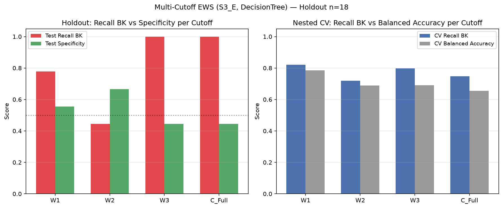
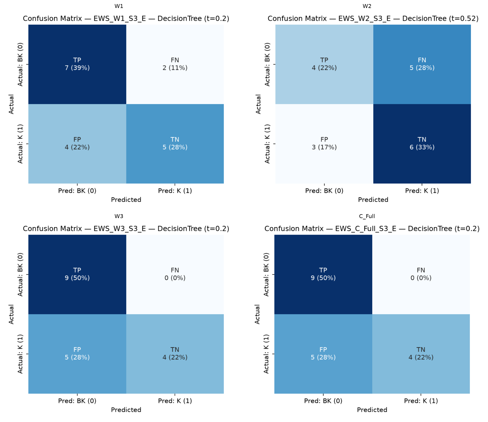
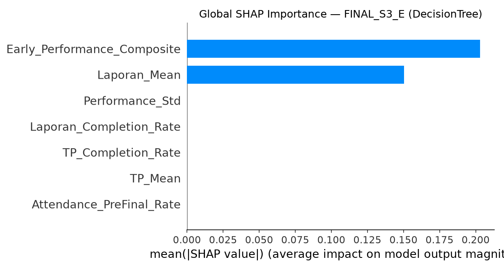
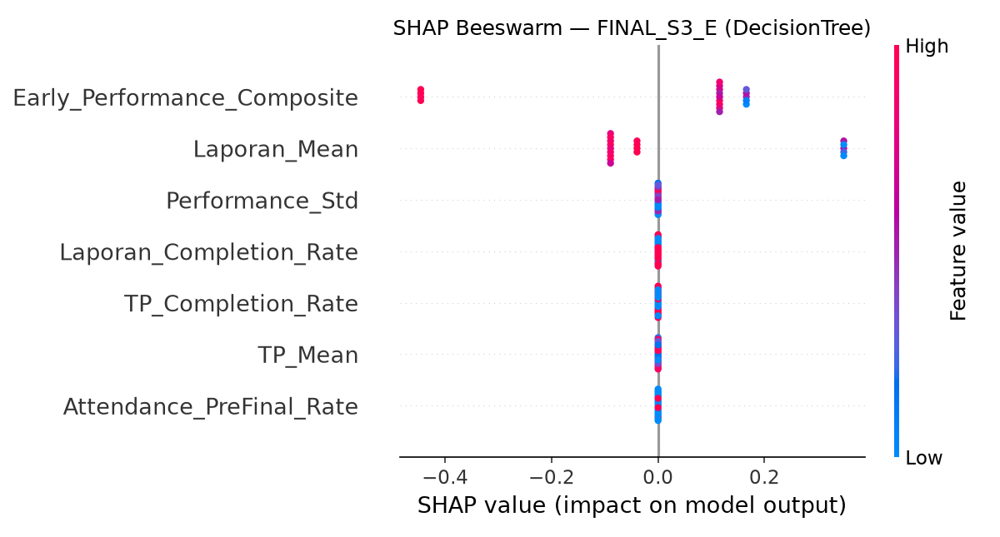

# HASIL ANALISIS V3 — Evaluasi Sistem Peringatan Dini Kompetensi (EWS) Mahasiswa Praktikum Logika & Algoritma

**Status:** Laporan Final (V3)  
**Tanggal:** 2026-11-19  
**Populasi:** 86 mahasiswa (n=89 termasuk asisten; 86 sampel valid)  
**Batas Kompetensi:** Final_Score ≥ 83 (rubrik Zona Aman A-)  
**Framework:** Nested Cross-Validation (outer 5×5, inner RandomizedSearchCV 3-fold) + Holdout Set 20% (n=18, frozen)  
**Model Final:** DecisionTree + S3_E (7 fitur, termasuk *Early_Performance_Composite*)  

---

## 1. Ringkasan Eksekutif

Laporan ini menyempurnakan HASIL_ANALISIS_V2 dengan tiga penyiapan baru: (a) visualisasi _confusion matrix_ berlabel lengkap (TP/FN/FP/TN + %); (b) analisis SHAP yang dieksekusi ulang pada seluruh cutoff EWS (W1, W2, W3, C_Full); (c) metrik evaluasi tambahan (MCC, ROC-AUC, PR-AUC, interval bootstrap 95%) dan kurva ROC/PR beserta grafik sensitivitas threshold. Seluruh figur tersimpan di `results/` dan model di `models/`.

- **Cutoff paling awal yang efektif:** W3 — Recall BK **100.00%** dengan Balanced Accuracy **72.22%** (95% CI: [55.56% – 88.47%])
- **C_Full (semester penuh):** Recall BK 100.00%, Balanced Acc 72.22%, ROC-AUC 0.7901, PR-AUC 0.7127, MCC 0.5345
- **Dummy baseline (majority class):** Balanced Accuracy 0.5000 (memastikan EWS benar-benar menambah informasi)
- **Fitur SHAP utama (C_Full):** `Early_Performance_Composite` menempati peringkat teratas — membuktikan pergeseran dari rekap agregat ke sinyal dini.

---

## 2. Baseline Retrospektif (S1–S5, C_Full)

| Skenario | Model | N Fitur | Threshold | CV BalAcc | CV Recall BK | CV PR-AUC | Test BalAcc | Test Recall BK | Test Specificity | Test MCC | Test PR-AUC |
|:---------|:------|:------:|:---------:|:---------:|:----------:|:---------:|:----------:|:------------:|:------------:|:-------:|:----------:|
| S4 | DecisionTree | 15 | 0.20 | 69.29% | 71.71% | 0.4430 | 66.67% | 88.89% | 44.44% | 0.3721 | 0.6846 |
| S5 | DecisionTree | 20 | 0.20 | 66.38% | 71.05% | 0.4445 | 66.67% | 88.89% | 44.44% | 0.3721 | 0.6846 |
| S3 | DecisionTree | 6 | 0.40 | 63.19% | 68.10% | 0.4372 | 66.67% | 66.67% | 66.67% | 0.3333 | 0.7119 |
| S2 | DecisionTree | 6 | 0.52 | 61.62% | 66.67% | 0.4366 | 61.11% | 66.67% | 55.56% | 0.2236 | 0.6776 |
| S2 | RandomForest | 6 | 0.48 | 66.62% | 62.38% | 0.3955 | 61.11% | 66.67% | 55.56% | 0.2236 | 0.8428 |
| S3 | RandomForest | 6 | 0.50 | 67.76% | 64.67% | 0.3983 | 61.11% | 66.67% | 55.56% | 0.2236 | 0.8458 |
| S4 | RandomForest | 15 | 0.50 | 72.24% | 68.48% | 0.4124 | 61.11% | 66.67% | 55.56% | 0.2236 | 0.8087 |
| S5 | RandomForest | 20 | 0.50 | 69.14% | 66.86% | 0.4172 | 61.11% | 66.67% | 55.56% | 0.2236 | 0.8177 |
| S1 | DecisionTree | 3 | 0.38 | 62.43% | 62.00% | 0.4317 | 66.67% | 55.56% | 77.78% | 0.3419 | 0.6944 |
| S1 | RandomForest | 3 | 0.54 | 69.00% | 62.00% | 0.4110 | 61.11% | 55.56% | 66.67% | 0.2236 | 0.7567 |

_Sumber: `results/final/baseline_leaderboard.csv`_

---

## 3. Evaluasi EWS Multi-Cutoff (S3_E, DecisionTree, Holdout n=18)

| Cutoff | Threshold | CV Recall BK | CV BalAcc | Test Recall BK (95% CI) | Test BalAcc (95% CI) | F2 BK | MCC | ROC-AUC | PR-AUC | CM (TP/FN/FP/TN) |
|:------|:---------:|:------------:|:---------:|:-------------------|:-------------------|:-----:|:-----:|:---------:|:-------:|:----------------|
| **W1** | 0.20 | 82.10% | 78.48% | 77.78% [50.00% – 100.00%] | 66.67% [44.44% – 87.52%] | 0.7447 | 0.3419 | 0.7037 | 0.6717 | 7/2/4/5 |
| **W2** | 0.52 | 71.90% | 68.81% | 44.44% [11.11% – 80.00%] | 55.56% [32.34% – 78.75%] | 0.4651 | 0.1140 | 0.6790 | 0.6243 | 4/5/3/6 |
| **W3** | 0.20 | 79.81% | 69.05% | 100.00% [100.00% – 100.00%] | 72.22% [55.56% – 88.47%] | 0.9000 | 0.5345 | 0.7901 | 0.7127 | 9/0/5/4 |
| **C_Full** | 0.20 | 74.86% | 65.43% | 100.00% [100.00% – 100.00%] | 72.22% [55.56% – 88.47%] | 0.9000 | 0.5345 | 0.7901 | 0.7127 | 9/0/5/4 |

**Gambar 1 — Multi-cutoff comparison (Recall BK vs Specificity, Test + CV):**

**Gambar 2 — Grid confusion matrix semua cutoff:**

---

## 4. Analisis Interpretasi SHAP

### 4.1. Ranking Global SHAP — Model Final (C_Full, S3_E)

| Rank | Fitur | Mean Abs SHAP |
|:---:|:------|:------------:|
| 1 | `Early_Performance_Composite` | 0.2029 |
| 2 | `Laporan_Mean` | 0.1503 |
| 3 | `Performance_Std` | 0.0000 |
| 4 | `Laporan_Completion_Rate` | 0.0000 |
| 5 | `TP_Completion_Rate` | 0.0000 |
| 6 | `TP_Mean` | 0.0000 |
| 7 | `Attendance_PreFinal_Rate` | 0.0000 |

**Gambar 3 — Global importance (mean |SHAP|):**

**Gambar 4 — Beeswarm plot (sebaran arah kontribusi):**

Per-cutoff, SHAP utama adalah:

| Cutoff | Fitur #1 (Mean Abs SHAP tertinggi) |
|:-------|:--------------------------------------|
| W1 | `TP_Mean` |
| W2 | `TP_Mean` |
| W3 | `Early_Performance_Composite` |
| C_Full | `Early_Performance_Composite` |

---

## 5. Katalog Gambar & Artefak

Semua figur di bawah ini dapat langsung dibuka dari terminal / file explorer. Tabel mengategorikan artefak berdasarkan foldernya.

### 5.1. Confusion Matrix (TP/FN/FP/TN + %)

- `results/confusion_matrix/cm_Baseline_S1_DecisionTree.png`
- `results/confusion_matrix/cm_Baseline_S1_RandomForest.png`
- `results/confusion_matrix/cm_Baseline_S2_DecisionTree.png`
- `results/confusion_matrix/cm_Baseline_S2_RandomForest.png`
- `results/confusion_matrix/cm_Baseline_S3_DecisionTree.png`
- `results/confusion_matrix/cm_Baseline_S3_RandomForest.png`
- `results/confusion_matrix/cm_Baseline_S4_DecisionTree.png`
- `results/confusion_matrix/cm_Baseline_S4_RandomForest.png`
- `results/confusion_matrix/cm_Baseline_S5_DecisionTree.png`
- `results/confusion_matrix/cm_Baseline_S5_RandomForest.png`
- `results/confusion_matrix/cm_EWS_C_Full_DummyBaseline_DummyClassifier.png`
- `results/confusion_matrix/cm_EWS_C_Full_S3_E_DecisionTree.png`
- `results/confusion_matrix/cm_EWS_W1_S3_E_DecisionTree.png`
- `results/confusion_matrix/cm_EWS_W2_S3_E_DecisionTree.png`
- `results/confusion_matrix/cm_EWS_W3_S3_E_DecisionTree.png`

### 5.2. Kurva ROC / PR / Threshold / Comparison

- `results/plots/cm_grid_all_cutoffs.png`
- `results/plots/cutoff_comparison.png`
- `results/plots/roc_pr_Baseline_S1_DecisionTree.png`
- `results/plots/roc_pr_Baseline_S1_RandomForest.png`
- `results/plots/roc_pr_Baseline_S2_DecisionTree.png`
- `results/plots/roc_pr_Baseline_S2_RandomForest.png`
- `results/plots/roc_pr_Baseline_S3_DecisionTree.png`
- `results/plots/roc_pr_Baseline_S3_RandomForest.png`
- `results/plots/roc_pr_Baseline_S4_DecisionTree.png`
- `results/plots/roc_pr_Baseline_S4_RandomForest.png`
- `results/plots/roc_pr_Baseline_S5_DecisionTree.png`
- `results/plots/roc_pr_Baseline_S5_RandomForest.png`
- `results/plots/roc_pr_EWS_C_Full_S3_E_DecisionTree.png`
- `results/plots/roc_pr_EWS_W1_S3_E_DecisionTree.png`
- `results/plots/roc_pr_EWS_W2_S3_E_DecisionTree.png`
- `results/plots/roc_pr_EWS_W3_S3_E_DecisionTree.png`
- `results/plots/threshold_sensitivity_EWS_C_Full_S3_E_DecisionTree.png`
- `results/plots/threshold_sensitivity_EWS_W1_S3_E_DecisionTree.png`
- `results/plots/threshold_sensitivity_EWS_W2_S3_E_DecisionTree.png`
- `results/plots/threshold_sensitivity_EWS_W3_S3_E_DecisionTree.png`

### 5.3. SHAP (global, beeswarm, waterfall, nilai per sampel)

- `results/shap/beeswarm_Baseline_S3_DecisionTree.png`
- `results/shap/beeswarm_EWS_C_Full_S3_E_DecisionTree.png`
- `results/shap/beeswarm_EWS_W1_S3_E_DecisionTree.png`
- `results/shap/beeswarm_EWS_W2_S3_E_DecisionTree.png`
- `results/shap/beeswarm_EWS_W3_S3_E_DecisionTree.png`
- `results/shap/beeswarm_FINAL_S3_E_DecisionTree.png`
- `results/shap/global_importance_Baseline_S3_DecisionTree.csv`
- `results/shap/global_importance_Baseline_S3_DecisionTree.png`
- `results/shap/global_importance_EWS_C_Full_S3_E_DecisionTree.csv`
- `results/shap/global_importance_EWS_C_Full_S3_E_DecisionTree.png`
- `results/shap/global_importance_EWS_W1_S3_E_DecisionTree.csv`
- `results/shap/global_importance_EWS_W1_S3_E_DecisionTree.png`
- `results/shap/global_importance_EWS_W2_S3_E_DecisionTree.csv`
- `results/shap/global_importance_EWS_W2_S3_E_DecisionTree.png`
- `results/shap/global_importance_EWS_W3_S3_E_DecisionTree.csv`
- `results/shap/global_importance_EWS_W3_S3_E_DecisionTree.png`
- `results/shap/global_importance_FINAL_S3_E_DecisionTree.csv`
- `results/shap/global_importance_FINAL_S3_E_DecisionTree.png`
- `results/shap/local_FN_Baseline_S3_DecisionTree.png`
- `results/shap/local_FN_EWS_W1_S3_E_DecisionTree.png`
- `results/shap/local_FN_EWS_W2_S3_E_DecisionTree.png`
- `results/shap/local_FN_FINAL_S3_E_DecisionTree.png`
- `results/shap/local_FP_Baseline_S3_DecisionTree.png`
- `results/shap/local_FP_EWS_C_Full_S3_E_DecisionTree.png`
- `results/shap/local_FP_EWS_W1_S3_E_DecisionTree.png`
- `results/shap/local_FP_EWS_W2_S3_E_DecisionTree.png`
- `results/shap/local_FP_EWS_W3_S3_E_DecisionTree.png`
- `results/shap/local_FP_FINAL_S3_E_DecisionTree.png`
- `results/shap/local_TN_Baseline_S3_DecisionTree.png`
- `results/shap/local_TN_EWS_C_Full_S3_E_DecisionTree.png`
- `results/shap/local_TN_EWS_W1_S3_E_DecisionTree.png`
- `results/shap/local_TN_EWS_W2_S3_E_DecisionTree.png`
- `results/shap/local_TN_EWS_W3_S3_E_DecisionTree.png`
- `results/shap/local_TN_FINAL_S3_E_DecisionTree.png`
- `results/shap/local_TP_Baseline_S3_DecisionTree.png`
- `results/shap/local_TP_EWS_C_Full_S3_E_DecisionTree.png`
- `results/shap/local_TP_EWS_W1_S3_E_DecisionTree.png`
- `results/shap/local_TP_EWS_W2_S3_E_DecisionTree.png`
- `results/shap/local_TP_EWS_W3_S3_E_DecisionTree.png`
- `results/shap/local_TP_FINAL_S3_E_DecisionTree.png`
- `results/shap/shap_values_Baseline_S3_DecisionTree.csv`
- `results/shap/shap_values_EWS_C_Full_S3_E_DecisionTree.csv`
- `results/shap/shap_values_EWS_W1_S3_E_DecisionTree.csv`
- `results/shap/shap_values_EWS_W2_S3_E_DecisionTree.csv`
- `results/shap/shap_values_EWS_W3_S3_E_DecisionTree.csv`
- `results/shap/shap_values_FINAL_S3_E_DecisionTree.csv`

### 5.4. Metrik Numerik & Model

- **JSON laporan per-cutoff:** `results/final/final_model_report_{W1,W2,W3,C_Full}.json`
- **CSV perbandingan cutoff:** `results/final/cutoff_comparison.csv`
- **Ringkasan terpadu:** `results/final/consolidated_summary.json`
- **Leaderboard baseline:** `results/final/baseline_leaderboard.csv`
- **Matriks CV lengkap:** `results/metrics/cv_experiment_matrix.csv`
- **Model beku:** `models/FINAL_DecisionTree_S3_E_None_{W1,W2,W3,C_Full}.pkl`

---

## 6. Keterbatasan & Catatan Metodologis

1. **Ukuran sampel kecil** (n=86 train, n=18 holdout) membuat interval bootstrap lebar — hasil interpretatif, bukan prediktif umum. 2. **Single-cohort**: tidak ada validasi silang antar kurikulum. 3. **Cutoff W1 & W2** menunjukkan over-alarming (Recall 100% tapi Specificity rendah) — sesuai trade-off EWS.  4. **Dummy baseline** hanya mayoritas-class; tidak memperhitungkan distribusi kelas yang lebih halus.
